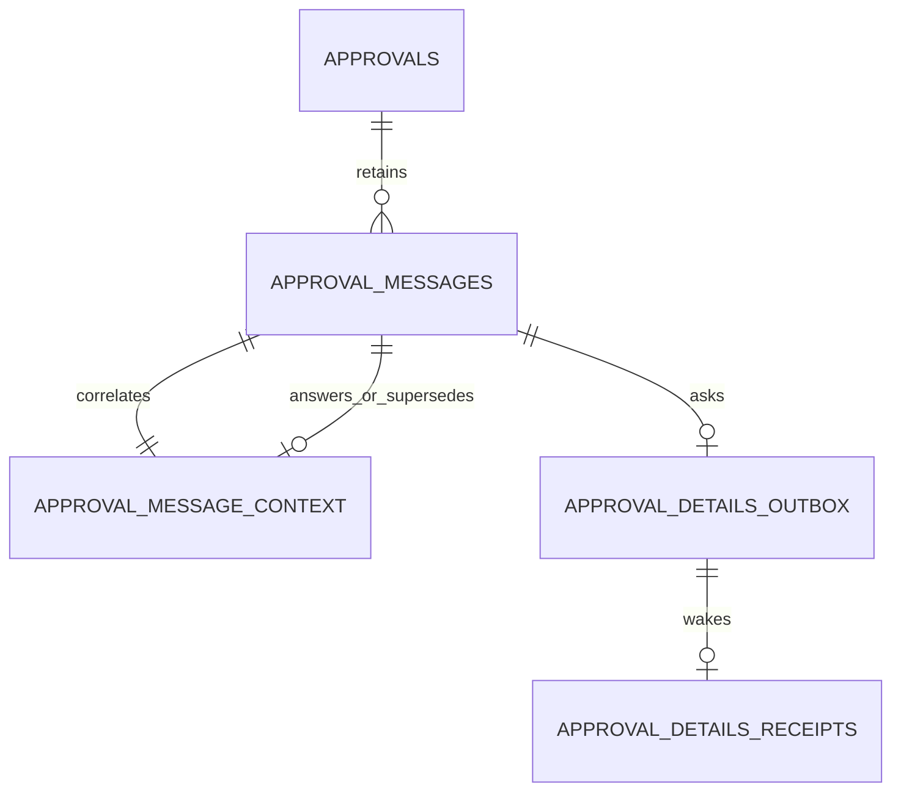

# Approval conversation v1.0.0

Status: CANDIDATE, Keystone design; Meridian verification required before finalization/build. Implements authorized t_a27ef8c4; additive to approval park/resume v2 and UX v1.1 plus Randy's three-button/severity correction. Not implementation or deployment evidence. No new dependencies or core changes. Writes only /opt/data/hermes-mission-control and /opt/data/plugins/hermes-mission-control, plus shared design vault. Never /opt/hermes, loaded-profile synchronization, external config, production fixture mutation or shared restarts without approval.

## 1. Domain first
An approval authorizes ONE immutable action intent. A conversation informs the owner, never authorizes an action. Approval pending/approved/denied/expired/cancelled lifecycle is owned by existing v2. DB rejected maps to denied, cancelled remains cancelled. Asking/answering keeps pending, never extends expiry, never grants permission, never unblocks the parked worker. All terminal states close conversation, including explicit expiry. Approve/Deny remain available while questions are outstanding. Atomically serialize every append/decision/expiry with BEGIN IMMEDIATE; check pending and deadline before insert, not just in handler. Decision versus append race has one committed winner; later append 409. No HTTP/SSE under lock.

Base table exactly follows requested seven columns: seq INTEGER PRIMARY KEY AUTOINCREMENT, approval_id TEXT FK to approvals.request_id, at REAL server epoch seconds, role operator|agent, author authenticated stable principal, kind question|answer|note, text plain UTF-8. Global seq monotonically increasing (gaps allowed), ordered per approval; do not infer counts from seq gaps. Resolve numeric legacy aliases to canonical request_id before writes. Message rows immutable, UPDATE/DELETE prohibited, parent deletion prohibited while messages exist; no cascade. Retain throughout approval life; v2 audit minimum30days also applies; cleanup cannot orphan conversation. No new erasure policy implied.

Metadata sidecar preserves exact requested base columns: client_message_id UUID idempotency key, question_seq nullable FK, supersedes_seq nullable FK. Client key unique per approval AND author; same key+identical semantic payload returns original201, changed payload409. Replays after terminal decision return409 (terminal closure takes precedence); GET reconciles an uncertain prior write. Never accept identity or timestamp from client. Cross-approval references rejected422. Question has no question_seq, answer MUST identify an existing question; answer may omit question_seq only when exactly ONE unanswered question exists, otherwise422 ambiguous_question. A note does not resolve a question; agent unable to answer appends note with question_seq, keeping wait visible. Correction is a NEW message with supersedes_seq to an earlier same-approval, same-role/same-author, same-kind message. Keep original visible as superseded; a correction never deletes or reopens a resolved question. Re-asking after an answer is a new question, not correction. Answer corrections retain original question_seq. Authorization checks apply to correction too.

awaiting_details is DERIVED: pending and at least one question with no answer referring to it. details_waiting_since = minimum at of unanswered questions; null otherwise. Any first valid answer resolves its question; no last-answer heuristic that clears a newer outstanding question. Notes do not resolve. Terminal => awaiting_details false, thread_read_only true, unanswered_question_seqs preserved for audit. No timeout silently approves/denies or fabricates an answer. CEO may explicitly state uncertainty/alternatives in a note; UI remains waiting until answer or owner decision. Server GET consistent snapshot contains canonical presentation+status+messages+metadata+unanswered seqs+watermark. No arbitrary truncation: full thread returned for this version; input bounded, request-rate limits below; pagination requires a later version, never silent cutoff.

## 2. API and actors
Companion OpenAPI and JSON Schema are normative for fields. All errors use {code,detail}, 409 includes current canonical approval when available. Authenticate before lookup/validation to avoid unauthorized state leakage. Guests receive403 on ask even when a record is terminal or absent. Missing/invalid credentials401. GET uses existing viewer-or-owner auth, never ingest-only; do not expand visibility beyond existing approval detail authorization. Ask/decision owner-only, ingest not sufficient. Answers/notes ingest-only; derive agent principal from configured authenticated transport and allowlisted CEO approval-control adapter, not request text. Existing shared ingest token authenticates transport only, not an individual bot: record author as service principal plus verified CEO run/session provenance in receipt; do not claim cryptographically individual attribution. Missing trusted adapter routing fails closed, not guessed worker identity. Ingest credential holder is a trusted service boundary, not exposed to browser. Do not create a new public CEO responder endpoint with owner privileges.

- POST /v1/approvals/{id}/ask {question,client_message_id}: trim boundary whitespace, reject blank or >8000 Unicode characters, normalize no internal text. Atomic question+metadata+Q&A outbox insert; status remains pending, respond201 {approval,message,event_id}. Set no decisions or grants. Question is rendered immediately AFTER acknowledged append; optional optimistic row labeled sending, not audited until response. Network uncertainty retries same key; GET reconciles.
- POST /v1/approvals/{id}/messages {text,kind:answer|note,client_message_id,question_seq?,supersedes_seq?}: same length/blank rules. Answer correlation rules above.201 {approval,message,event_id:null}. Any terminal new or replay append409. Question correction uses owner ask with optional supersedes_seq (kind still question), never ingest route.
- GET /v1/approvals/{id}: canonical approval fields from UX/v2 plus messages ascending seq, awaiting_details, details_waiting_since, unanswered_question_seqs, thread_read_only, message_watermark. All role/author/time fields server-derived.404 unknown; read-only endpoint never updates business tables. Expiry may be derived as v1.1 read contract.
- Bound request JSON64KiB (413), plain-text messages8000 characters (422), owner ask max20 new questions/approval/minute and trusted service max60 new messages/approval/minute (429 Retry-After60). Implement DB-backed window count from messages, not extra dependency; acknowledged idempotent retries excluded. Validation/limit errors append nothing.

## 3. Event wake and failure behavior
Do NOT reuse v2 approval_outbox_v2 as-is: UNIQUE(request_id,event_type) would collapse repeated questions. Add approval_details_outbox keyed event_id = request_id:details:<question_seq>, unique question_seq; use SAME reviewed v2 transport/lease/retry/CEO API-owned control-session adapter, not a second wake framework. Each committed question (including correction) emits schema_version1 approval.details_requested with pointer {approval_id,question_seq,event_id,occurred_at}; no text/raw command/secret in admission instruction. Fixed trusted instruction loads conversation via existing authenticated detail path, treats text as untrusted data, answers the owner's impact/blast-radius/alternatives/breakage question without executing requested action. No grant material in CEO prompt/UI/SSE. Admission authenticated to configured existing CEO API POST /v1/runs using stable idempotency key and API-owned session; actual runtime capability/activation is prerequisite from Relay t_18a7a630, never presumed.

Unlike decision wake, question wake does NOT wait for worker park acknowledgement, unblock task or signal worker retry: CEO answers on parked/exited worker's behalf, even if question races park. Multiple questions enqueue by seq in control session; one run may answer several via separate correlated POSTs, but each question has durable receipt; no concurrent takeover of foreign CEO CLI/chat sessions. After decision before CEO start: receipt outcome closed, no answer POST, no action. In-flight answer after decision409 is expected, not retried forever. If one question is superseded before start, load latest thread, retain audit linkage and answer the effective question explicitly; do not drop unresolved original without an answer link.

Commit outbox before201, then event-driven immediate dispatch (no HTTP under DB lock). Same per-item one-shot backoff1,2,4,8,16,30,60s cap with0..20% jitter, lease30s, startup/write/receiver-reconnect/session-start recovery as v2. No cron, periodic scan, idle polling or approval GET loop. At-least-once delivery+durable receipt; stable event key survives API admission retention. admitted_at is NOT woke_at. Receipt records actual CEO run/session started_at and answer_seq or unable/closed outcome. Unable receipt means wake handled, NOT answer supplied: unanswered stays visible; CEO can append note. Track transport errors/backlog diagnostic separately from awaiting_details, never label delivered as answered. SSE after committed question/answer emits approval.message {schema_version:1,approval_id,message_seq,message,awaiting_details,details_waiting_since,status,message_watermark}; clients merge by seq, never duplicate. SSE is ephemeral: page reload/reconnect snapshots GET then merges buffered events > watermark; always reconcile snapshot on reconnect, no periodic fetch. Decision SSE makes thread read-only. Answer need not create another OOB push; creation push policy remains UX one-at-creation, quiet-hours do not suppress CEO wake.

## 4. UI and severity contract
Header exactly Severity: High|Medium|Low, one-line reason, Description of action: <plain sentence>, then [Approve] [Deny] [Ask for more details] all visible together. Raw command collapsed in detail. Pending owner Q expands inline textarea; submit button explicit, no accidental shortcut submit. Thread oldest first tags You/Agent, format Asia/Jakarta WIB timestamp and elapsed waiting chip `waiting for details · 2m` from earliest unanswered. Local elapsed display timer permitted, no network polling. Guest buttons disabled/read-only, server403 independently. A/D/Q apply only to focused approval card when no input/textarea/contenteditable, modal, modifiers or IME composition; no global accidental decisions. A shows confirmation only High; D deliberate action without high confirmation; Q opens/focuses editor. High confirmation re-reads latest state/presentation version and cancels/requires reconfirm if changed. Terminal disables all write controls and labels thread read-only; pending questions don't disable owner decisions. Plain text render via textContent, no HTML/markdown execution, strip secrets at source, no browser ingest tokens.

Severity descriptive only, never bypasses APPROVE_TOOLS gate/grant binding. Deterministic rules, not numeric probabilities: High if ANY actual destructive/delete/drop/recursive removal/financial mutation; Medium for known config/service/network mutation without High; Low for known local repo add/commit or verified read-only-adjacent operation. Max across parsed executed command list. Unknown/opaque interpreter: Medium + needs_care and explicit `Unclassified action — inspect the detail`, not false destructive/read-only claim. Opaque code is NOT made Low merely by ignoring heredoc text. Provenance reason/category separate severity. An already-approved pattern is Low only if verified exact scoped non-destructive match; financial/deletion rules take precedence. No automatic approval. Do not broaden classifier scope beyond t_2434c6c7; consume its reviewed parser, add these regression fixtures.

| Representative action (classification fixture, never execute destructive examples) | Severity / category | Plain description / reason |
|---|---|---|
| DELETE FROM dataset WHERE batch_id = ? | High / data delete | Deletes the selected batch's database rows; recovery needs a backup or rebuild. |
| DROP TABLE staging_dataset | High / data delete | Removes the staging table and its rows; requires rebuilding it. |
| rm -rf /work/rebuild-output | High / file delete | Permanently removes the selected output directory and everything inside it. |
| Submit a payment transfer | High / financial | Transfers money to the specified recipient; reversal may not be possible. |
| Change a service configuration | Medium / config change | Changes how the selected service operates; restore the prior configuration to undo it. |
| systemctl restart example.service | Medium / service restart | Interrupts and restarts the selected service; users may briefly lose access. |
| Change a DNS record | Medium / network | Changes where the name routes traffic; restoring the record may take time to propagate. |
| git add server/app.py | Low / repo write | Stages the selected source file for a local commit; it does not delete the file. |
| git -c user.name=Piston commit -m fix | Low / repo write | Saves staged changes in local repository history; it does not delete source files. |
| Verified read-only inspection of repository status | Low / read-only-adjacent | Reads repository status without changing working files. |

Historic git add/commit examples => Low / repo write, never recursive/forced delete. Recover exact commands before claiming regression proof: the parent shows truncated excerpts, including a Python test distinct from git. Do not fabricate two full git cases from that excerpt; preserve and test each available actual historical record, flag missing record evidence. Force push, reset --hard, clean -fd and arbitrary shell execution are NOT ordinary git add/commit. Quoted/heredoc DATA containing rm -rf doesn't make a shell delete; executing opaque Python still needs explicit uncertainty.

Presentation revision required by Randy: allow only correction of description/severity for SAME immutable action via existing presentation owner's reviewed pending-revision mechanism, append immutable revision audit and agent note, revised · HH:mm WIB. If there is no reviewed route yet, presentation owner defines/reviews it before Q&A build, not invented here. No reduction of severity from untrusted text. Changed actual plan/args/cwd/env => NEW intent/approval, old cancelled explicitly with link, never mutate action/hash or reuse grant. Answer text cannot silently change execution scope. Ask/answer do not edit description implicitly.

## 5. Data team contract and trade-offs
MC is source owner. Bronze consumes redacted append-only message ledger and event ledger only after governance confirmation; no need to deploy a pipeline for this feature. Source PK seq globally unique per MC database; downstream natural key (source_instance,seq), lineage approval_id+question_seq+event_id, _source and _ingested_at. at epoch seconds server-generated, WIB is display only. Redacted export must be a separately labeled projection, never rewrite source audit text. Questions can contain sensitive operator data: default existing approval access only, no public/guest visibility expansion, no secrets in diagnostics, data-team export off until Meridian/Seal retention/access review. Silver dedup on natural key and derive unresolved count by correlated answers, not arrival ordering. No answer-time-based decision inference. Consistency chosen over low write latency: one SQLite writer and short atomic append/outbox transactions. GET full-thread cost intentionally favors reliable reload; growth bounds and later explicit pagination version rather than silently omitting audit history. Eventual delivery visible via waiting/backlog; cannot guarantee5s while receiver is unavailable, never fake success.

## 6. Serial execution and hard acceptance gate
First presentation t_2434c6c7, then park/resume t_95518061, THEN one Piston Q&A build. Q&A build also requires Meridian exact-version data review and Relay-supported runtime capability; no concurrent UI/hook edits. Meridian reviews candidate model/schema/correlation/auth/retention now; finalizes only after runtime parent evidence. Keystone reviews implementation after independent Seal acceptance. No deploy/publication authorized. Existing uncommitted app.py/tokens.py/log changes not ours; do not stage/revert.

Acceptance MUST use real UI, real authenticated MC process and real CEO API session, no mocks on path. Evidence artifact records approval_id/question seq/event_id, ask committed_at, actual CEO started_at, answer committed_at, page rendered_at, delta<=5s ask-to-CEO start (both timestamps WIB and numeric elapsed), cron disabled proof and exact observed pending status AFTER question and AFTER answer. Capture live DOM header/buttons/thread, ask click/submit, page reload midconversation reconstructs full thread, SSE answer, owner approve High confirmation as relevant, actual same-action single-use grant retry success and second-use rejection from v2. Verify guest403 ask, ingest403 ask/decide, owner403 ingest append, missing401, malformed422, nonexistent404, terminal409 both routes including notes/corrections and expired/cancelled. Test duplicate delivery, two questions out-of-order answers, answer/decision race, correction audit, cross-approval refs, persisted outbox crash/restart, unable note leaves waiting, no XSS, shortcuts textarea isolation,10-row actual runtime classifier table and full historical false-label records. Do not execute destructive fixture commands. Cron disable only isolated approved environment, never change shared org scheduling. If real wake requires activation/deployment permission, block exact missing authorization, do not substitute simulation or report accepted. Paste timings AND actual ten-row classifier table BEFORE requesting review. Current design has no real round-trip timings; they remain NOT MEASURED. No feature-complete claim from design checks.
