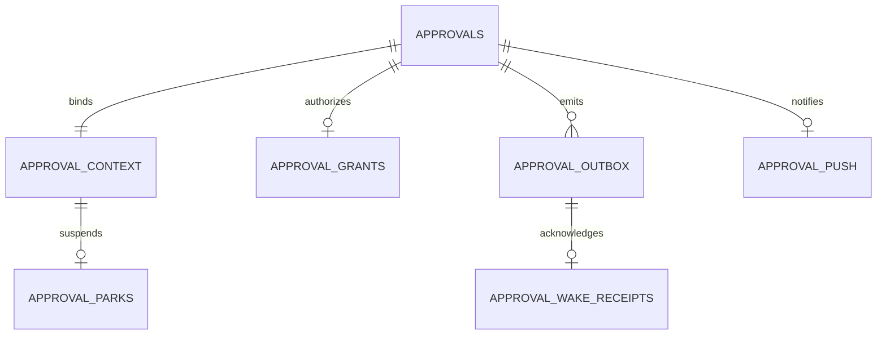

# Approval park/resume contract v2.0.0

Status: PROPOSED; Randy/CEO authorized replacement model in t_7136560e. Meridian compatibility/data review required before implementation. Supersedes v1 human-wait transport and v1 escalation scheduling; does not weaken the fail-closed allowlist. Keystone is designer, Piston implementer, Seal independent acceptance. No deployment authorized.

## 1. Domain and invariants
Approval is an immutable action intent plus pending/approved/rejected/expired/cancelled decision state. Transport failure is NOT a human decision. Pending lasts independently of worker lifetime, default seven days per CEO correction on t_19b8576c, with configurable longer lifetime. Expiry is explicit expired + reason, never denied. No automatic seven-day deletion. Evaluate expiry on read/write/session-start and one-shot deadline callback (not periodic scan); conditional pending->expired transaction emits event. A timestamp aged25h remains pending. All displayed timestamps WIB; persisted timestamps epoch seconds.

Context binds request_id, board identity, card_id, originating profile/session/run, stable intent_id, tool_name, exact effective args and execution context. Missing board context on a board-worker request fails closed as invalid_context. Non-board sessions return pending and end their turn without manufacturing a card; resume through their supported originating surface only, with compatibility evidence first.

Canonical hash v1: SHA256 of UTF8 json.dumps({hash_version:1,profile,board_id,card_id,intent_id,tool_name,args,execution_context},sort_keys=True,separators=(',',':'),ensure_ascii=False,allow_nan=False). Reject duplicate JSON keys and non-JSON values. No Unicode normalization, shell rewriting, whitespace trimming, or secret redaction before hashing. Execution context includes resolved absolute cwd, terminal environment/backend identifier, effective explicit env overrides and runtime identity. Resolve defaults BEFORE approval; changes invalidate grant. Timeouts/background/persist flags in args count. Host environment and mutable file contents are NOT attested: action authorization, not content sandbox. Summary/presentation and grant metadata are excluded. Reject mutations of immutable context on reused request_id/intent_id with409. Cap canonical action64KiB. Store a redacted detail for UI; never store credentials unredacted or grant plaintext in logs/events/transcripts.

Grant is an opaque256-bit random bearer capability, SHA256-only stored, bound to approval, hash and originating profile/board/card/intent. Mint once transactionally with approval; default expires_at=decided_at+600 seconds. Denial/expiry/cancellation cannot mint. Consume once with atomic conditional UPDATE under BEGIN IMMEDIATE; check approved status, all bindings, now<expires_at, consumed_at IS NULL and presented digest constant-time comparison. Commit BEFORE allowing actual tool execution. A mismatch must not consume a valid grant. Replay=grant_consumed; expiry=grant_expired; changed action=grant_action_mismatch. No fallback to making another prompt on invalid/replayed grant. A retry with NO grant for a consumed intent returns execution_state_unknown, not a new approval. Crash after consume/before tool completion has UNKNOWN execution; never automatically execute again. This is at-most-once authorization, not exactly-once business effects. Reapproval is an explicit new owner decision on a new intent, not automatic token renewal. Expired unconsumed grants keep original approved decision visible; card blocks with grant_expired and an explicit reapproval need.

## 2. Protocol: no human wait in hook
1. Existing conservative read-only bypass remains before any network call. Gated invocation checks scoped runtime grant first. Otherwise POST /v2/approvals/requests with stable UUID request_id/intent_id and context. Transaction inserts existing approvals row + context + creation event + push claim. Repeated exact request is idempotent, does not re-notify. Only a durable commit permits approval_pending. No fire-and-forget emitter queue is proof of persistence.
2. pre_tool_call MUST return a block directive immediately after creation response, with structured result {code:"approval_pending",approval_id,card_id,action_hash,park_required:true,display:"approval pending: <id>"}. Framework may stringify envelope; JSON must remain parseable in resulting tool error. Never execute original tool. Target whole hook<2s, including a hard outer1500ms transport/persist cap; on unavailable/unknown commit, return approval_unavailable and retain stable request_id for idempotent retry. Never fabricate pending. New path contains no /wait, sleep, human-decision future, periodic fetch or semaphore waiting. Old bounded waiter remains isolated compatibility fallback only, reduced to <=1.5s hard cap when v2 is enabled; MUST NOT be reachable from pre_tool_call.
3. Worker uses canonical kanban_block(kind=needs_input, reason=approval_pending:<request_id>) then exits. Board lifecycle/park acknowledgement calls MUST be excluded from this business-action gate; otherwise parking deadlocks again. Do not exempt arbitrary terminal/execute_code based on their text. Register a narrowly scoped plugin park helper only if installed runtime provides supported canonical board API. Return code alone is insufficient: prove actual blocked state and worker exit. Hook cannot rely solely on an LLM remembering to park: plugin/runtime finalization adapter must ensure the park, or fail compatibility gate rather than shipping.
4. After canonical block is confirmed, plugin POST /v2/approvals/{id}/parked with expected board/card/run and block generation. Server records parked_at and opaque generation. Decision transaction always persists its outbox event, including before park. Dispatcher may admit that event to the CEO only after park acknowledgement exists; /parked triggers a drain of any already-persisted decision event. No lost wake between decide and park: both operations conditionally ensure unique event_id=request_id:decision:1; the decision transaction owns event creation and /parked never changes its payload. A pre-park decision is retained, not marked delivered or discarded. Block overwrite by unrelated needs_input must not be undone. If worker crashes before acknowledgement, worker-exit event/session-start reconciliation handles this; prove supported exit hook or block deployment. No periodic board scan.
5. Owner MC/authorized Discord decision POST goes through ONE shared transaction: compare pending state/deadline, derive actor from authenticated principal (body decided_by is display-only, never identity), update approval + grant if approve + outbox event + audit. No HTTP calls under DB lock. Signed Discord links require expiry validation, owner-equivalent authority and deliberate POST; GET never mutates. Both decision entry points use this transaction, not independent divergent functions.
6. Outbox dispatcher posts event through authenticated local CEO API admission. Chosen public surface: POST /v1/runs at configured loopback CEO api_server with API_SERVER_KEY, Idempotency-Key=stable outbox event_id and body input containing a FIXED instruction plus structured event pointer, session_id of an API-owned CEO approval-control session. This is the EXISTING default/CEO profile, NOT a new bot; never hijack the messaging/CLI CEO session. Official API rejects foreign-surface session_id with409 permission_denied. Verify /v1/capabilities.run_submission and installed endpoint shape before build. First control session bootstrap and target id must be confirmed in compatibility report; no guessed existing id, port or key. Auth/config activation remains separately permission-gated. Do not put grant tokens or raw commands into API prompts. Event payload is data, not executable instructions.
7. Deterministic plugin wake adapter validates outbox pointer/auth and latest decision, then CAS-unblocks ONLY matching approval block generation using supported canonical board API. It records durable wake receipt, resulting card state, actual CEO run/session-start timestamp and dispatcher event signal. CEO control-session prompt communicates outcome; LLM latency must NOT be on the deterministic unblock path. No direct SQL updates to shared kanban.db or Hermes state.db, no import of private control internals. If installed public integration cannot perform this, compatibility task blocks with exact missing supported interface/authorization. HTTP202 by itself is admission, NOT proof CEO was woken or card resumed. <5s evidence uses actual CEO session event, not request send timestamp.
8. Resumed worker loads pending decision/grant via session-start plugin callback, NOT model-visible args/history. Claim grant token at protected endpoint: plaintext regenerated as HMAC-SHA256(secret, request_id|random grant_id|token_version), base64url; stored digest still sole validation value. Signing secret independent from ingest/owner/API keys, in approved secret config. Derivation context length-prefixes fields (4byte big-endian byte length), not ambiguous delimiter concatenation. grant_id random256bits, token_version1; never expose secret. This reconciles recoverable single token delivery with hash-only database storage; rotating key revokes unconsumed grants explicitly. Hook recomputes effective action hash and consumes grant server-side, then returns allow exactly once. Tokens remain plugin memory only. A resumed agent that edits args gets rejection, not another prompt. Rejected decision wakes/re-enters reporting path but never tool execution.

## 3. Delivery and crash semantics
Transactional outbox persists before decision HTTP200; crash before commit means no decision acknowledgement and client safely retries same idempotent decision_id. Crash after commit/before response: retry returns original decision, no second grant. Kill test must cover BOTH windows, and include restart after decision commit while wake receiver is unavailable. A request that never reached a dead MC cannot magically persist: UI reports unacknowledged, retries same decision_id after reconnect; do not claim server accepted it.

At-least-once delivery; independent durable receipt keyed event_id prevents duplicate board wake. Lease outbox items with bounded one-shot timers only for concrete outstanding items: backoff1,2,4,8,16,30,60s capped60 with jitter0..20%; restart/startup, next write, receiver-reconnected event and CEO session-start trigger drains. No cron, interval timer, periodic global scan, idle poll or repeated GET loop. Retry timers are permitted only to retry failed outstanding deliveries (not detect new work); when queue empty no timer. Lease30s allows recovery from dispatcher death on next startup/event; no periodic sweep configured, even as primary fallback. After a network response timeout, keep stable idempotency key, never mint a fresh event. Session-start reads outstanding decisions/receipts, including approved+unconsumed, denied and expired, not only still-valid grants; paginated100 with cursor and stable ordering. Session-start reconciliation is a lifecycle event, not scheduled scan.

Event acknowledgement separates admitted_at, ceo_started_at, card_unblocked_at and acknowledged_at; outbox delivered means durable receiver receipt plus safe board transition, not bare HTTP200. No bound on human decision time, no keeping request sockets/workers open. Retry/grant expiry does not change pending into rejected. Unblock must be idempotent across crash after board CAS/before receipt: compare generation and record already-applied marker through canonical board interface.

## 4. Notification amendment (authoritative over UX v1.0)
Exactly one creation-time out-of-band push ATTEMPT carrying validated summary through existing configured channel Randy checks (MC_DISCORD_WEBHOOK_URL when confirmed). Suppress push+sound at [23:00,06:00) Asia/Jakarta; badge/banner/SSE/toast always update. No deferred06:00 ping, no2min/10min escalation, no polling cron. Mark suppressed_quiet rather than pending-for-resend. Native browser Notification is opt-in, hidden-tab only, suppressed quiet hours. Push attempt is durable claim before I/O, one total; crash/uncertain delivery is visibly uncertain, no automatic duplicate push. This at-most-once attempt trade-off is distinct from at-least-once decision wake outbox. UI uses event id dedup and initial snapshot fallback; no tokens in SSE. Existing approval_pings v1 table is obsolete, do not implement its scheduler. Preserve plain summary/what_it_does/affects/reversible/detail and seen semantics from UX contract. Apply this correction to t_2434c6c7 and Seal t_f0b2e22c acceptance.

## 5. Boundaries, audit and data contract
All source/test/doc writes ONLY /opt/data/hermes-mission-control/ and /opt/data/plugins/hermes-mission-control/. No /opt/hermes access/change required; no new dependency. Do not sync loaded copies, restart shared gateway, change external config or deploy without permission. Canonical MC SQLite is owner of decisions/grants/outbox; Hermes/kanban remains owner of worker/session/card state. Cross-database transaction impossible: use idempotent saga + generation CAS, not assumed atomicity. WAL+short transactions favor consistency and strict single-use grants over extra network latency; fail closed on store outage.

Additive v2 SQL is proposed sidecar migration, leaves existing approvals schema compatible. Existing readers map rejected->denied; STOP mapping cancelled->denied. API returns distinct expired/cancelled and reason. Historical rows lacking context are viewable but not resumable: explicit new intent needed, never auto-mint historical grants. Events approval.created/decided/parked/wake_admitted/ceo_started/card_unblocked/grant_consumed/grant_expired/push_outcome use schema_version2, event_id, request_id, board/card/profile, hash_version/action_hash, correlation_id, actor principal, occurred_at epoch, reason_code. No raw args, credential material or bearer grants in event projections. Bronze may ingest append-only redacted event ledger, dedupe event_id in Silver; decisions are terminal except explicit admin cancellation/revocation audit. Meridian validates correlation/lineage/retention before approval. Retain audit30days minimum; secrets and grant token never downstream. Pending/undelivered/unknown records excluded from retention cleanup until explicitly resolved.

## 6. Sequence and owners
- t_508a98ba: Piston exclusively owns separate-source hook until reviewed DONE; bounded safety valve only.
- t_2434c6c7: same Piston serialized presentation build AFTER interim; no grants/wake edits. Preserve uncommitted auth changes in server/app.py/tokens.py.
- New Relay compatibility card: read-only capability investigation + isolated harness ONLY within allowed trees. Prove public deterministic park/finalization/worker-exit, canonical CAS-unblock + dispatcher signal, API-owned CEO event-session admission and plugin runtime grant injection; identify activation permissions. If unavailable, BLOCK with evidence, no core hacks.
- Meridian reviews this candidate contract and compatibility evidence BEFORE final design acceptance/build. Piston v2 build depends on compatibility+Meridian+interim+presentation. One v2 implementer owns both plugin copies; no parallel hook edits. Seal independently reproduces six acceptance groups, browser/push correction and auth negative tests.

## 7. Mandatory acceptance evidence (not satisfied by this design)
A1 actual isolated gated tool call timing<2s; parse JSON pending code; exact durable row; blocked card generation; exited worker/no live idle connection. Offline/fake slow transport honest unavailable<2s, stable retry id, no bypass.
A2 cron disabled in isolated test environment (record command/state), real decision and actual CEO session-start with WIB timestamps delta<=5s; actual board transition and dispatcher wake signal. ACK-only, synthetic event stubs and LLM promise are not proof. Duplicate/early decision before parked and unrelated-block race tests.
A3 real consume succeeds once; concurrent second consumed rejected; changed action rejected without consuming; fake-clock now==expires rejected; other board/profile/card/intent rejects. Crash after consume yields unknown, no automatic execution. Demonstrate grant never appears in model-visible result/SSE/log.
A4 actual isolated MC/receiver process kill/restart with file-backed DB, committed outbox survives, restart drains without cron; submit-during-unreachable UI retry proves no false acknowledgment. Crash around every commit/admission/receipt/CAS boundary, stable event keys.
A5 manipulate requested_at to25h while default7days ->pending, card remains blocked, no denied; then>7days ->explicit expired/reason, never denied. Human absence causes no socket/worker hold.
A6 source search all loaded-source hook copies: no wait or longpoll reachable; <=1.5s fallback cap demonstrated, no900s. Full tests/diff checks, exact commits and on-disk vs loaded-source path/activation gap. No dangerous fixture commands actually execute.
Notification: source/table of ten truthful summaries retained from UX; real SSE/UI badge/banner/title/toast/native delivery evidence; capture one creation-time push and zero repeats after manipulated ages, quiet boundaries, replay/restart. Do not claim local webhook capture equals real Discord delivery.

## Sources inspected
Current MC server/app.py decision paths613/698 and wait733, server/db.py207 commits decision without outbox; emitter/plugin/emitter.py111 blocks900s. Actual hook copy being repaired separately in /opt/data/plugins/hermes-mission-control. Official https://hermes-agent.nousresearch.com/docs/user-guide/features/api-server documents API-owned sessions, durable /v1/runs admission, Idempotency-Key24h and foreign-surface409. Official developer-guide/middleware documents fail-open middleware: DO NOT use a raising middleware as fail-closed approval enforcement. Official developer-guide/plugins/public-api governs supported imports. Installed compatibility NOT assumed from latest docs.
