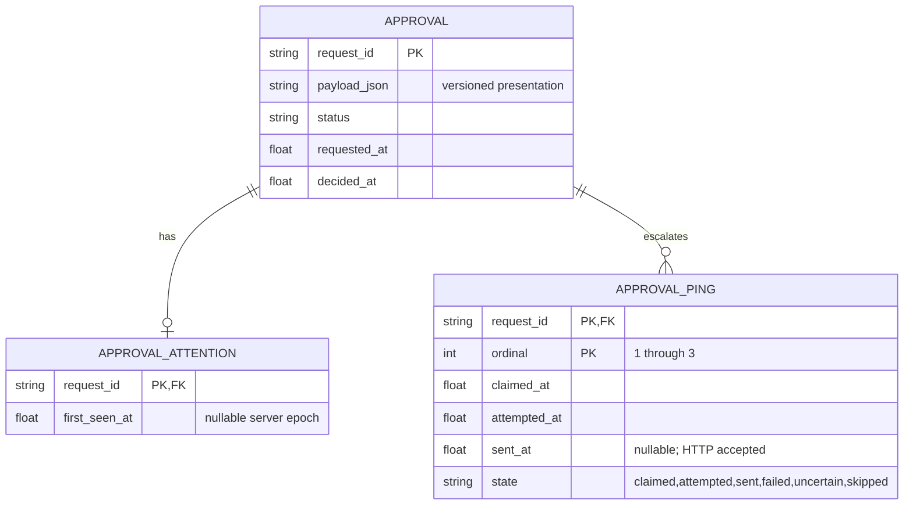

# Approval presentation and notification contract v1.0.0

Status: PROPOSED for Meridian contract review, then Piston implementation. Owner: Keystone. Task: t_19b8576c. This document is a build contract, NOT evidence of implemented behavior. No deployment or publication authorized.

## 1. Scope and discovered boundaries

Write only `/opt/data/hermes-mission-control/`; never `/opt/hermes`, installed profile plugins, config, or shared databases during tests. No new dependencies. Existing source: `emitter/plugin/__init__.py` regexes scan whole command strings; `emitter/plugin/emitter.py` emits only action/risk; `server/app.py` persists a reduced payload and discards new fields; `server/db.py` maps payload to API; `web/index.html` renders action/text. Fix the whole repository-local path, not only a dashboard string.

Parallel t_508a98ba owns bounded wait, outcome messaging and read-only bypass in `/opt/data/plugins/hermes-mission-control/`. It is a DIFFERENT source tree. Wait for its completion before repository-local emitter integration. Preserve its approved behavior and port its reviewed bounded implementation only into this repository if needed; never overwrite its source. No profile-copy synchronization or restart. Report repository-local versus loaded behavior explicitly. Current unstaged app.py/tokens.py changes are another card's auth work; never stage/revert them wholesale.

Presentation classification NEVER grants permission, bypasses a gate, changes APPROVE_TOOLS, or starts a tool. Keep gate selection policy independent, including the bounded-card's allowlist. A repo write may remain subject to legacy policy without being called deletion. A legacy false-positive approval may still appear but must have a truthful headline. Narrowing gate-selection false positives requires separate approval; do not silently change which calls block while fixing labels.

## 2. Domain and invariants

Approval identity is existing `request_id`; numeric id remains backward-compatible. Existing lifecycle pending -> approved/rejected/cancelled remains unchanged. Seen is telemetry, not consent. Agent timeout is not operator denial. Late approval never resurrects an expired tool invocation; pending legacy rows can remain waiting until timeout-card lifecycle integration explicitly closes them. UI must not claim that deciding a stale row ran a command.

Each approval carries summary, what_it_does, affects, reversible, detail plus classification and needs_care. `action` and SSE `text` are compatibility aliases of summary, NEVER command prefixes. See companion JSON Schema. `reversible=false` means no guaranteed safe rollback (including unknown); true means ordinary local change with a recoverable prior state, NOT guaranteed restoration. UI label: 'Undo is possible' versus 'Undo is not guaranteed'. `affects=none` on unknown means no target confidently identified, NOT harmless; unknown always needs_care=true. Additional classification field prevents this ambiguity being hidden.

Absent summary invokes deterministic generation. Present but null/empty/whitespace/overlength/multiline/shell-like summary is rejected by the source and server with 422 before any approval event or row is committed. Do not trim an explicit empty value into a generated title. Agent-supplied valid prose is displayed but does not override classification, needs_care, affects, reversibility or policy. Unknown always uses EXACT headline `Unclassified action — inspect the detail` (put agent suggestion in detail metadata if supplied). Summaries must be imperative, <=80 Unicode characters, single-line, without shell operators/command code. Reject controls, backticks, `&&`, `||`, pipes, heredoc markers, `$(` and `${`; semantic imperative/plain-language quality comes from deterministic templates and tests, not an unbounded LLM call.

`detail` preserves full command, not a truncated headline, through existing mandatory secret redaction. Redact BEFORE persistence/SSE/logging. This is deliberately secret-safe raw detail, not byte-identical credential retention. Never put detail in toast, browser notification or Discord. Escape every displayed field using textContent or equivalent; no HTML injection.

Use additive tables from companion SQL; store structured summary in existing payload_json, avoiding a table rebuild. Legacy rows are normalized at read time using full detail if available, otherwise exact unknown fallback; NEVER trust legacy action prefixes as a classification. Do not mutate historical event evidence or claim a truncated action reconstructs full command. Ensure db._approval_dict, reducer pending lists, /v1/state, GET approvals, and SSE expose identical presentation. New rows persist contract version 1.0.0. Identity and timestamps remain stable across replay; no repeated notifications from duplicate event IDs/request IDs.

## 3. Deterministic classifier, not a shell interpreter

Implement a bounded, stdlib-only lexer with quote state and heredoc delimiters. Parse command lists `;`, newline, `&&`, `||`, pipes and redirections outside quotes. Handle backslash escapes, leading assignments, `cd` context and supported wrappers (`env`, `command`, sudo with known options); resolve git global options (`-C`, `-c key=value`, `--git-dir`, `--work-tree`) before its subcommand. Inspect executable/subcommand and semantically relevant arguments, not occurrence of words anywhere. Quoted argv operands are DATA, not command verbs. Quoted executable names still execute. Redirection to a file is a write. Multiple heredocs and `<<-` must be consumed with the correct delimiter, never re-tokenized as shell commands.

Do not assume heredoc means read-only. A literal quoted heredoc fed to a recognized non-executing consumer can ignore its body for SHELL risk. Python/shell interpreters execute bodies: `bash -c 'rm -rf …'`, `sh <<EOF …`, substitutions, eval, xargs/find -exec, obfuscated commands or unsupported grammar become unknown/needs-care unless their nested executable context is explicitly understood. Never execute a command to classify it. If parsing fails or resource budget is exceeded, unknown, not safe. Bound input at 64 KiB and tokens at 4096; over-budget -> unknown, preserve redacted detail, do not drop the gate.

Python heredoc can be read-only-test ONLY for a bounded AST-proven test harness: imports from explicit safe modules, loading a known local test module, running a named unittest/pytest suite, no arbitrary calls, process launch, network, file writes or dynamic eval. If full code cannot be proven, classify unknown with no delete label. The supplied historical excerpt `python3 - <<'PY' import importlib.util, sys, subprocess...` is truncated and cannot prove read-only; recover full event command before asserting read-only-test. Importing subprocess alone is not a delete; executing arbitrary subprocess is not safe. This distinction must remain honest in acceptance evidence.

For multiple recognized verbs build a composed plain-language effect and choose primary affects deterministically: money > service > repo > files > none. Different resource domains set needs_care=true and mention all known effects in what_it_does. Any unknown executable context -> unknown headline; never silently hide unknown portions behind a known git command. reversible is true only if ALL effects have an ordinary recoverable undo and there are no unknown effects. Force push/deletion, process kill, restart, spending, network mutation default false. chmod and sed without backup also false. Generic curl POST is network-write with unknown remote effect (needs care); known DNS/spend adapters must use exact host/path/method and structured arguments, never keyword matching `dns`/`spend` in prose.

### Required classification fixtures (DESIGN EXPECTATIONS, not executed output)

| Representative input | classification | summary | what_it_does | affects | reversible |
|---|---|---|---|---|---|
| git -c user.name=Piston add server/app.py && git commit -m fix && git push origin main | repo-write | Save and publish the repository changes | Saves the staged changes and sends them to the main branch on the remote repository. | repo | false |
| sed -i s/old/new/g config.ini | file-write | Update the configuration file | Replaces matching text in the configuration file without making a backup. | files:config.ini | false |
| rm -rf build | delete | Delete the build folder | Permanently removes the build folder and everything inside it. | files:build | false |
| kill -TERM 1234 | process-control | Stop process 1234 | Asks process 1234 to stop and may interrupt its work. | none | false |
| systemctl restart nginx | service-control | Restart the web service | Stops and starts the nginx service and may interrupt requests. | service:nginx | false |
| chmod 600 secrets.txt | permissions | Restrict access to the secrets file | Changes file permissions so only its owner can read and write it. | files:secrets.txt | false |
| curl -X POST https://example.invalid/api | network-write | Send a change request to the remote service | Sends a request that may change data on the remote service. | service:example.invalid | false |
| structured action_kind=dns-change, zone=example.invalid, record=www, value=192.0.2.1 | dns-change | Change the website address record | Points the website address to the specified server and may affect reachability. | service:dns | false |
| structured action_kind=spend, amount=5, currency=USD, provider=test | spend | Authorize the five dollar purchase | Requests a purchase of five US dollars from the specified provider. | money | false |
| mysteryctl --do-it | unknown | Unclassified action — inspect the detail | The action could not be classified confidently; inspect the detail before deciding. | none | false |

Structured DNS/spend fixtures must traverse the SAME summary API as commands; plain shell keyword guesses do not count. Also cover a simple git add/commit (repo-write, reversible=true for local ordinary commit only), the full historic git command, verified test-only Python harness, quoted `printf '%s' 'rm -rf /'` (read, not delete), heredoc to cat (read, not delete), interpreter heredoc with deletion (unknown or understood delete, never read), command substitution, write redirection, escaped separators, missing delimiters, Unicode and shell injection in summary. Never run dangerous fixture commands.

## 4. API and event integration

Keep existing /v1/events envelope and ingest authentication. Event data adds companion-schema presentation fields, classification metadata, tool and optional structured action metadata; legacy action supported. Normalize/validate approval events BEFORE event insert, so invalid summary does not leave an event counted accepted but no row. Validate entire batch before committing any item (422 and zero batch side effects on invalid approval). Commit event + approval in one transaction; notify/broadcast only on newly inserted approval after commit. Duplicate replay must not reset seen time or schedule.

GET /v1/approvals and /v1/state and SSE approval share canonical fields; add first_seen_at. API timestamps remain epoch seconds; UI times and quiet-hours are Asia/Jakarta/WIB. Add POST /v1/approvals/{identifier}/seen with `_require_owner`, idempotent, server timestamp only, no client clock/identity authority. 200 canonical approval, 404 missing; no lifecycle change. Owner page submits only after the card is actually rendered while document.visibilityState=visible and intersects viewport; banner alone is not seen. Hidden tabs/replayed background SSE are not seen. Guest/anonymous/ingest credentials cannot mark seen or decide. Preserve guest read-only security patch, signed decision links, 409 conflict behavior and existing waits. Do not modify timeout messages owned by t_508a98ba.

## 5. UI contract

Create an explicit Approvals section/header if current queue mixes approvals with tasks. Header badge is outside collapsing content. Sticky top banner displays count, oldest pending age in minutes and oldest summary. Clicking expands panel, scrolls to oldest row and focuses it. Unknown has a visible 'Needs care: not classified' indicator, not color alone. Details collapsed initially; show effect, target and undo warning before buttons. Empty/malformed legacy summaries get exact unknown fallback at server AND client defense.

Pending title alternates base title `Onendo mission control` and `(N) Approval waiting — Onendo mission control` every 1500ms; cleanup timer and restore base title when count=0. Honor prefers-reduced-motion: static pending title instead of flashing. Pending count derived from id-deduplicated map shared by full state and SSE. Reconnect/replay updates banner/badge but does not duplicate arrival toasts/notifications; first page hydration is silent, genuinely new pending IDs toast. Race-safe reconciliation must not resurrect a decided row from an older snapshot.

Arrival toast has summary and inline Approve/Deny using existing authenticated POST, disabled for guests, disabled during in-flight decision, handles 409 by refreshing, never treats 403/network error as approval. Accessible live region and keyboard actions. Browser notification opt-in button requests permission only on explicit click, once per browser choice; persist enabled/declined/denied in localStorage, tolerate blocked storage. No automatic permission prompts. Notification only when granted+enabled and document hidden; tag=request_id, summary only, silent=true during quiet hours; click focuses page and jumps to row, does not approve. Native permission denial is not an application error. Use real browser Notification API; mocked call does not prove an OS notification. Badge/banner remain when notification unsupported.

## 6. Escalation semantics and consistency trade-off

One bounded scheduler per server lifespan, DB-persisted claims, 5s sweep. First ping eligible at server requested_at+120s, then >=600s after last ATTEMPT; MAX THREE TOTAL pings (approximately ages 2,12,22 minutes), not initial+three repeats. Replace unconditional arrival Discord call for approvals; otherwise 'exactly one at 2 minutes' is false. Use MC_DISCORD_WEBHOOK_URL only; no bot fallback for escalation. Missing webhook surfaces configuration diagnostic, no faux sent record. Use configured explicit operator mention only if already available; never invent a Discord user or @everyone. Without one, webhook channel notification is the ping and report that limitation.

Quiet interval [23:00,06:00) Asia/Jakarta, evaluated at dispatch time using injectable server clock. During quiet hours: no Discord send and no sound; do not consume slots. At 06:00 send ONE overdue ping, not backlog bursts, then wait 600s. Age is never reset by seen. Seen approvals still pending continue bounded escalation with 'seen, awaiting decision' versus 'not yet seen'. Decisions stop future sends. Recheck pending and quiet hours immediately before outbound attempt.

Claim (request_id,ordinal) transactionally under MC write lock/SQLite uniqueness, record attempted_at durably BEFORE network send, then bounded HTTP request and store sent_at only on successful HTTP response. Multiple tabs/processes must not duplicate a claimed slot. A 429, HTTP error, timeout or crash after attempt consumes slot; next attempt no sooner than 600s, max three. On restart a claimed-but-unattempted slot can be dispatched after recheck; an attempted-but-unconfirmed slot becomes uncertain, NEVER immediately retry. This is AT-MOST-ONCE ATTEMPT, not exactly-once Discord delivery: webhook lacks idempotency and a crash can lose a ping. Prefer no duplicate spam over guaranteed delivery; expose uncertainty in diagnostics. 'Exactly one ping' acceptance requires one captured successful send in the deterministic healthy fixture, not a global exactly-once claim. No webhook under DB lock or unbounded threads. Reuse stdlib bounded HTTP transport, no dependency.

## 7. Verification and release evidence required from build

1. Actual runtime output table for ten fixtures above plus both recovered historical examples; clearly distinguish expected table here from observed output. If full historic Python command unavailable, report evidence gap; do not call arbitrary Python read-only.
2. Regression tests for quote/heredoc/non-shell matching and all fallback/empty-summary edges at emitter, event batch, DB adapter, SSE, full state and UI. Assert no legacy raw headline and replay duplicates cannot trigger ping/toast.
3. Isolated actual uvicorn, auth, database and pending approval, with DOM assertions + screenshot for badge collapsed/expanded, sticky banner click/focus, title, arrival toast, decisions and native Notification on granted secure origin. Browser notification proof must include actual display/delivery evidence; if environment cannot deliver it, explicit blocker, not a mocked success.
4. Injectable clock: one captured outbound webhook at 120s, none before +600s; next slots max3; multi-worker/restart claims; 22:59/23:00/05:59/06:00 WIB boundaries; pending -> decided stops; seen/unseen text. A local real HTTP capture proves request bytes, not delivery to Discord. Real Discord acceptance needs configured webhook and response/message evidence, with test marker and cleanup where authorized. Never leak webhook or tokens into artifacts.
5. Full tests and diff --check, source hashes/commit, baseline and current health; no production dangerous commands, no production DB backdating, no shared service restarts. Actual loaded-profile and deployment gaps recorded. Implementation is not operational closure.

## 8. Data-team handoff and routing

Meridian reviews this version before build: request_id grain, immutable event/raw secret-safe retention, versioned payload, seen telemetry versus consent, notification at-most-once audit, additive schema and timestamps. Derived age/status displays stay read-model/UI, not source facts. Operational attention tables belong to MC; future lakehouse ingestion is append-only events plus change snapshots, not edits to Bronze. No new lakehouse pipeline requested.

Route serially: Meridian contract review -> Piston build (also waits on t_508a98ba) -> Seal independent auth/gate/notification safety acceptance. Piston owns all application code; no split file ownership or parallel classifier implementations. Any unresolved permission for installed plugin activation or deployment returns to CEO. Contract approval does not authorize deployment.
