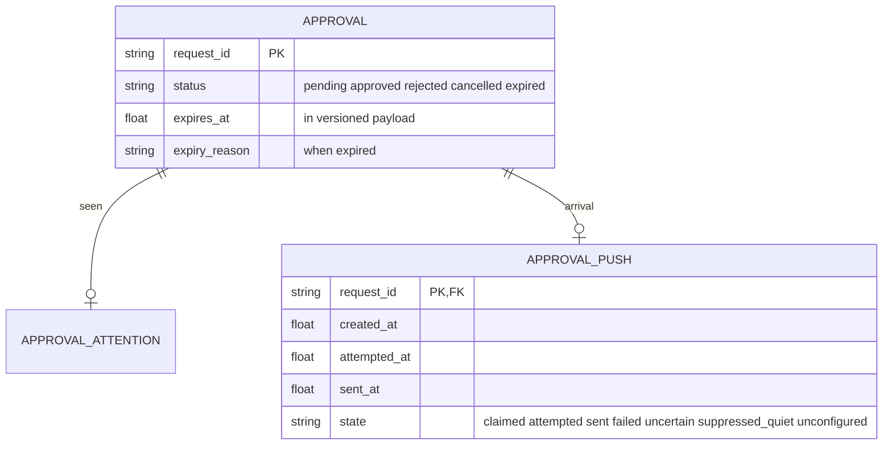

# Approvals UX v1.1.0 — CEO-authorized push and durable-pending amendment

Status: PROPOSED implementation contract, authorized scope correction from Randy via CEO on t_19b8576c. Requires Meridian review before Piston build. Supersedes ALL conflicting escalation/lifetime clauses in v1.0.0, Obsidian mirror and downstream card bodies/comments. No deployment authorization. v1.0.0 remains historical evidence, not current escalation requirements.

## Supersession map

- DELETE v1.0 section6 recurring scheduler, 5s sweep, first120s, subsequent600s, max3 pings and morning catch-up. NO notification polling, cron or repeat escalation.
- REPLACE v1.0 approval_pings SQL with v1.1 approval_pushes; do not execute obsolete draft migration.
- REPLACE v1.0 section7 escalation-timing acceptance with one creation-time push and quiet-hour proof below.
- REPLACE lifecycle statement allowing stale pending rows without explicit expiry policy with durable pending and seven-day default lifetime below.
- All original plain-language summary/classification accuracy, no-blank-summary, permission preservation, browser/toast/badge/banner/title/seen semantics, security restrictions, file scope, and real-evidence requirements remain. Presentation classification still NEVER grants or bypasses approval.

## 1. Push only, exactly one logical arrival notification

When a NEW approval is committed, emit existing SSE approval event immediately and invoke ONE out-of-band send through existing MC_DISCORD_WEBHOOK_URL, carrying summary, agent, link, age/lifetime and no raw command. This is the existing configured channel, not a newly invented notification destination. Build must demonstrate this is a channel Randy checks using known operator confirmation; if unknown, explicitly surface that missing routing confirmation. Never expose webhook secret or invent @everyone/operator mention. Browser notifications remain opt-in, triggered on SSE arrival for backgrounded tabs. Badge, banner, title and toast update immediately via SSE regardless of quiet hours.

No recurring notification worker, poll loop, cron, repeat attempt, delayed two-minute send, ten-minute resend or morning catch-up. One bounded post-commit background dispatch per newly inserted request_id is permissible: it is event-triggered push, not a polling scheduler. Duplicate event IDs AND different event IDs for the same approval must not create additional logical sends. No I/O under DB lock. Bound worker resources and request timeout without new dependencies. Dispatch cannot block approval ingest or tool wait.

Quiet interval [23:00,06:00) Asia/Jakarta/WIB is checked at creation and immediately before dispatch. Suppress sound and outbound push if either is quiet; keep in-page attention. Record suppressed_quiet and do not send later at06:00. In-page toast remains silent; background browser notification must not produce a native outbound notification during quiet hours (in-page badge/banner always continue). Nonquiet opt-in browser notification uses the actual Notification API. This intentionally replaces the v1.0 rule allowing a silent native notification during quiet hours: native notification is also push.

Creation-time out-of-band push is ONE logical send, not a promise of exactly-once delivery across remote network failures. Persist one per-request push claim/attempt before network I/O. No retries on timeout/uncertain send, no resend after restart; failed/uncertain/suppressed are visible diagnostic outcomes, never labeled sent. Delivery failure must be visible in the page (notification-delivery warning) so 'unmissable' is not a false claim. Exactly-one successful HTTP send is verified in healthy test conditions; actual Discord delivery requires real response/message evidence. A generic HTTP capture is not Discord delivery.

## 2. Durable approval lifecycle, separate from bounded tool wait

Default approval lifetime:604800seconds (seven days). Configuration approval_lifetime_s finite positive numeric; invalid/bool/nonfinite/nonpositive -> default. Server, not agent clock, chooses creation time and expires_at. Persist expires_at in versioned payload; missing legacy value derives from persisted requested_at+604800 without resetting age at replay. Override lifetime only through existing server settings mechanism, no agent-supplied untrusted deadline. Tests may inject clock/lifetime into isolated fixtures.

Pending remains pending until explicit operator approval/denial/cancellation or expires_at. Busy operator, hidden tab, never-seen row, tool wait timeout, transport error and lack of reply MUST NOT set denied/rejected or clear row. API exposes status `expired` separately from `denied`, with visible expiry_reason `Approval expired after its configured lifetime without a decision.` Explicit operator denial alone maps to denied. Expired rows appear in a recent history/status surface with summary, expiry time/reason and no enabled decision buttons, rather than silently disappearing. Pending badge counts pending only.

At or after now>=expires_at, server read models present expired even if durable transition is not yet materialized; decision path transactionally checks deadline and materializes expired, returning409 with canonical expired record and reason. Persist expiry state on an expiry-aware access in a write-capable handler, not by violating read-only DB adapters. Plain canonical getters may derive the expired state without writing. Replays never change expires_at. Frontend derives badge/banner countdown and explicit expired display from server expiry deadline; a one-shot local deadline timer updates it even without another SSE event, then refreshes canonical state. This is expiry handling, NOT notification polling/cron. No periodic escalation scheduler is added.

Hook execution wait remains bounded per t_508a98ba (default20s, reviewed hard cap). Waiting20s is NOT the approval lifetime. A returned tool call reports awaiting approval/unavailable as applicable and does NOT claim operator denial. Its durable approval stays pending. Preserve pending identity in result metadata where available so user can find it. Late approval records consent but never executes a finished callback or resurrects a tool. UI explicitly says `Decision saved; the original tool call is no longer waiting. Retry the action to continue.` when this condition is known; never assert a command ran just because approved. If existing hook cannot expose that condition, say `Decision saved; execution is not confirmed.` An automatic durable resume bridge is NOT silently introduced by this presentation task; any need to execute later without retry requires explicit separate contract. No denial-by-silence.

Wait endpoint must return expired as a distinct status. Plugin integration must handle it as expired/unavailable, never operator denial, preserving bounded wait. Existing timeout-card's policy wording is not permission to mutate durable state to rejected; refine confusing presentation via coordination, not an unbounded wait. Signed decisions and owner POST both enforce expiry atomically and never accept a late decision.

## 3. Domain and API amendment

Normalized schema contract_version=1.1.0. Add expires_at (epoch seconds), expiry_reason (nullable prose), push_state (nullable enum from table). Existing requested_at/server creation distinction must be explicit in server normalization: new expiry uses server received/commit time, never attacker-supplied event ts. User-facing times use WIB. Approval API status enum adds expired; wait API does too. Existing GET approvals may remain pending-only, but GET full-state exposes recent expired rows in approval_history, capped100 newest expiry with stable request_id ordering. Add owner/viewer-authenticated GET /v1/approvals/{identifier} for exact canonical any-status readback and UI refresh; this must precede static mount. Seen remains owner-only, not consent, does not extend expiry. Existing request_id and numeric lookup aliases unchanged.

Use companion v1.1 schema/OpenAPI/SQL, not v1.0's push-related tables. Normalized expiry state does not alter immutable event history; later state snapshots record explicit expired state/reason. Additive migration only. No source writes to Hermes DBs.

## 4. Required acceptance amendments

A. At creation: live SSE causes toast+badge+banner+title; real opt-in background browser Notification outside quiet hours; one configured out-of-band push with plain-language summary. Capture creation commit and outbound timestamps, prove dispatch occurs on creation path not a delayed scheduler. Healthy fixture exactly one outbound request and no later request after replay/reconnect/restart/clock advance. Require actual Discord evidence and channel routing confirmation; no mock success substitution.

B. Fake clock around22:59,23:00,05:59,06:00 WIB: quiet creation suppresses browser/out-of-band push/sound but not badge/banner/toast/title; no queued catch-up or repeated ping at06:00. A fresh06:00 approval pushes once. Show visible suppression/failure diagnostics.

C. After bounded tool wait ends, persisted row remains pending and shown as pending (not denied) even after2minutes/10minutes. Default expires_at is server creation+604800. At exactly expiry, explicit expired state/reason visible in history and canonical GET; POST decide cannot approve expired record and returns409 canonical reason. Expired is not mapped to denied by server, SSE, wait or plugin. Approved/rejected rows do not auto-expire. Late decision never claims tool execution. Test signed-link decisions too.

D. All original ten-command actual output table, recovered historic false-positive examples, quote/heredoc tests, no-blank-summary enforcement, auth-negative tests and screenshot/DOM evidence still required. No application behavior is claimed by this amendment; build and independent acceptance remain downstream.

## 5. Routing

Meridian t_fe901921 reviews v1.1 first; Piston t_2434c6c7 builds after Meridian and t_508a98ba; Seal t_f0b2e22c independently accepts. ALL three card bodies' old scheduler clauses are obsolete under this amendment. Preserve repository-only write scope; do not modify installed profile plugin trees or restart/deploy. CEO has authorized this architecture correction, not release.
