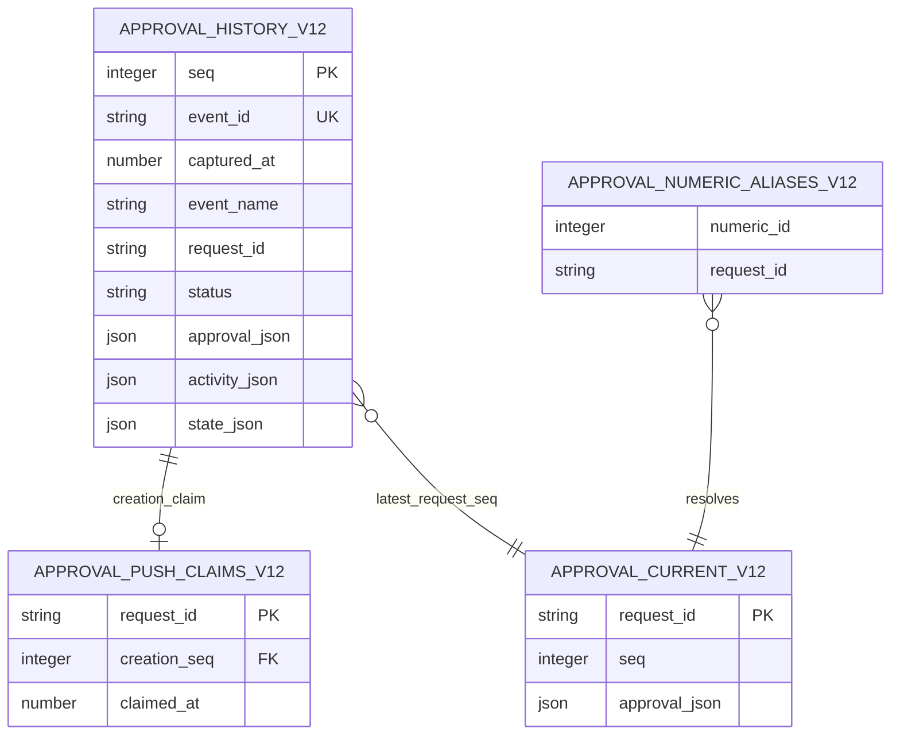

# Approvals UX v1.2.0 — corrected contract amendment

Status: CEO-ruled scope encoded; independent Meridian/Seal re-review and Kestrel consolidated verdict REQUIRED before build. Design only, not deployed or certified runtime behavior. Owner: Keystone. Source: task t_43f53b7b. This document is the normative amendment; companion OpenAPI, SQL and presentation JSON Schema reference named sections below.

Supersedes conflicting v1.0/v1.1 approvals and v2 park-resume interface clauses ONLY. Preserve prior plain-language presentation, classification, owner/viewer/ingest authorization, safe text rendering, opt-in browser notification, bounded wait, accessibility and real-browser acceptance requirements. Do not restore escalation scheduling or implement a resume bridge here. No deployment/publication authority.

## Status vocabulary

Canonical ordered vocabulary: `pending | approved | denied | cancelled | expired`.
This is the single semantic authority. All artifact enums/checks are mechanical copies; change this section and all copies together under versioned review.

### Input alias mapping

`rejected` → `denied`: legacy input alias only; normalize before validation on all compatibility input/import paths, never persist or emit the alias. Decision input accepts the two operator decision outcomes from the canonical vocabulary plus this alias; all other values return 422. Do not duplicate this mapping in other artifacts.

### Lifecycle and invariants

- Creation starts pending. Only authenticated explicit operator choice produces approved or denied. Operator decision metrics count ONLY these two statuses, with nonnull decided_at and decided_by.
- Cancellation means requester withdrawal (`requester_withdrew`) or independently confirmed worker death (`worker_died`) before a decision; it is neither an operator decision nor a denial. An authenticated lifecycle reporter MUST record confirmed worker death against all owned pending requests. Missing heartbeat, bounded wait timeout or broken transport alone is not proof of death. A timed-out callback may leave a living worker's request pending.
- Expiry is reached ONLY at server requested_at + 604800 seconds (7 days), with expiry_reason exactly `Approval expired after 7 days without a decision.` This CEO ruling supersedes the previous configurable-lifetime clause. No client deadline override. No silence-denial. No terminal state changes to another terminal state.
- Terminal administrative telemetry (seen, notification outcome) may change, but status, decided_at/by, cancellation/expiry reason remain immutable. Pending has null decision fields; cancelled/expired also have null decision fields. Nonexpired records have null expiry_reason. Cancelled requires one of the two reason codes above.
- A write transaction first checks existing terminal state, then deadline, then requested action. At deadline it emits an expiry event and returns 409 canonical expired record instead of accepting decision/cancellation. Double decision, including identical repeated decisions, returns 409 existing decision without overwrite or a second decision event. In a race the first committed terminal event wins.
- Wait is bounded 0–20 seconds, default 20; returns canonical Approval in any status. Timeout returns pending, never denial. Consent is not evidence a tool ran. Preserve v1.1 late-decision warning; no automatic callback resurrection.

## Domain and immutable history

SQL is executable design DDL for new MC-local v12 tables, NOT a production migration. Never touch installed Hermes databases. `approval_history_v12` is the authoritative append-only attention/event ledger; UPDATE/DELETE are forbidden by DB triggers, including deletion by retention sweep. Push claims and numeric alias bindings are also immutable. Existing mutable legacy approvals, attention and push rows are compatibility operational projections, NOT historical truth. After cutover every change to any operational projection MUST have a corresponding full canonical approval event and full state snapshot in this ledger in the SAME transaction; no unlogged mutation path is permitted (including signed decisions, seen, expiry, push outcomes and crash cancellation).

`approval_current_v12` is a view choosing the highest seq approval event per request_id, never a writable table. First event must be pending; later events contain full canonical replacement records, not patches. State snapshots contain pending approvals plus newest 100 terminal approvals (terminal time descending, request_id ascending tie-break). Terminal time is decided_at for operator decisions, expires_at for expiry, and the first cancellation event captured_at for cancellation; later seen/push updates do not reorder terminal history. The exact any-status endpoint is uncapped. Snapshot and list arrays are unique by request_id. Ingestion consumers use the full immutable event sequence, NOT the bounded UI history, to avoid losing cancelled/expired rows.

Expiry-aware reads MAY overlay expired for pending records whose deadline passed, using server clock and explicit reason without changing immutable history. They do not advance seq. GET at time t and an SSE payload at time t must use the same overlay function. Next write-capable lifecycle access materializes expiry before other changes. A one-shot browser deadline timer refreshes canonical state; no notification scheduler is implied. Replaying a stored historical snapshot uses its captured_at clock (not today's clock) to preserve point-in-time truth.

Write adapter requirements beyond SQL: validate closed presentation schema and all lifecycle/notification constraints; ensure full state_json agrees with the latest records plus this event; freeze terminal decision metadata; monotonic server timestamps; no raw fields. The SQL trigger enforces only structural/lifecycle subset, NOT semantic redaction or a whole application. Direct INSERT bypass of the validating write adapter is forbidden.

### Cutover and historical data

Import only scrubbed normalized canonical records. Seed a pending full record then a terminal full record where needed, preserving original server requested_at and decision facts, with distinct migration event IDs and no outbound sends. Missing legacy expiry derives requested_at+604800, never migration time. Unknown/unsupported legacy status or untrusted/missing creation time must stop cutover for explicit repair; never guess. Existing numeric aliases are imported as bindings; collision is retained for explicit 409 resolution, never arbitrarily deduplicated. Existing prior push/suppression/uncertainty consumes the creation claim; imports are never new arrivals. A complete additive/backfill/rollback migration remains Piston work after review. Preserve old documents as historical, not current implementation instructions.

## Identifier resolution

request_id is canonical, case-sensitive, opaque, 1–128 ASCII letters/digits/underscore/hyphen, used in all outputs/events/links. IDs failing this pattern or whose redaction would alter identity are invalid (422); never scrub an identity into another identity. Existing nonconforming IDs require explicit migration mapping before cutover.

Every identifier endpoint uses the SAME resolver, including seen, cancel, decision, wait and signed-link adapters. URL-decode once; reject invalid or duplicate id_kind. `id_kind=request_id` means exact string lookup (404 absent); `id_kind=numeric_alias` requires canonical nonnegative decimal `0|[1-9][0-9]*` in signed 64-bit range (422 malformed). Default auto: exact request_id match first, otherwise if canonical decimal use compatibility alias lookup; otherwise canonical lookup absent is 404. Force request_id mode for digit-only canonical IDs when intent is exact. Numeric aliases are never canonical outputs.

Numeric alias zero matches → 409 code unknown_numeric_alias, match_count 0, approval null; more than one distinct request_id → 409 ambiguous_numeric_alias, exact match_count, approval null, explicit redacted reason. One match resolves normally. No guessing or first-row selection. Error detail never echoes raw identity or candidate records to an unauthorized caller. Resolve after auth. Compatibility signed decisions must share resolution/deadline/409 logic, not a parallel mutation path.

## Replay and parity

OpenAPI names snapshot, activity, approval and defines separate typed data envelopes. On wire each record has `id: <decimal seq>`, `event: <name>`, `data: <JSON envelope>` and a blank terminator. Envelope fields: seq (integer), captured_at (server epoch seconds), data (typed payload). Seq is a globally increasing committed SQLite AUTOINCREMENT ledger key shared by all three event kinds, never per-request; gaps allowed. Heartbeats are SSE comments without IDs and are not stored events.

- snapshot.data = ApprovalState, exactly the GET /v1/approvals result and GET /v1/state.approval_state at the same seq and captured_at, including identical redacted Approval objects and presentation. Existing nonapproval /v1/state fields are preserved, outside this profile.
- approval.data = full canonical Approval; exactly the any-status GET record at that event seq/captured_at. No partial or raw representation. activity.data = closed Activity (id, type, received_at, summary), redacted. Apply approval events as replacements by request_id; activity never implies consent.
- Every live frame is backed by an immutable ledger row with its complete ApprovalState in state_json, committed BEFORE publication. Projection writes and snapshot insertion are one transaction. Server serializes seq publication; no later seq may be delivered before an earlier committed seq. This adds event-coupled stored snapshots; the old 30-second snapshotter alone cannot implement replay.
- First connection without Last-Event-ID: emit snapshot at current committed high-water seq, then stream seq greater than that cursor. Empty store uses seq 0 with empty arrays and server captured_at. Register streaming/replay watermark atomically to avoid a lost event race.
- Reconnect with Last-Event-ID N: validate canonical decimal and range; ensure N exists in retained store (0 allowed). Replay all rows seq>N in increasing order using original event name and typed payload from stored snapshots; then tail from the same watermark with no gap. Do not skip intervening activity/approval frames in favor of a newer snapshot. IDs too old/missing/future return HTTP 409 replay_unavailable before opening stream, with explicit reset instruction. Client clears cursor, GETs state, reconnects without header. Malformed header returns 422.
- Deduplicate by seq, discard seq <= last applied seq; request_id alone is not a dedupe key for distinct updates. Replayed arrival must not create a second native/outbound notification. Periodic snapshot frames may use new seqs, but never generate arrival notification. GET exposes current high-water seq, not a fabricated new cursor.

## Redaction boundary

Normative minimum reference: server/redact.py at commit b7f6d95 (git blob inspected), including IPv4/IPv6 patterns, supported vendor/MC tokens, webhook URLs, credential URL userinfo, NAME=value, secret key/value pairs, credential-like key names and webhook/DSN key names, .env paths and bare references. Apply recursive value scrubbing to every free-text field, not just detail. Allowlist object keys in closed schemas; reject unknown sensitive/dynamic keys rather than assuming scrub_obj scrubs dictionary keys (it does not). Unknown nested raw payload objects must not be stored. Redaction-changing identifiers return 422, never renamed.

| Surface | Mandatory boundary and evidence |
|---|---|
| persist | Scrub before first durable insert: ingress event values, canonical presentation, immutable history, state snapshots, compatibility projections, push audit and diagnostic logs. No raw request body, command, credential or query token in exception/access logs. Inspect DB and log fixture bytes, not just the rendered page. |
| API | Scrub again before serialization of list/state/exact/wait and every error/409 payload. Viewer/owner responses share the restriction. Verify raw response bytes and headers; never echo unsafe validation input. |
| SSE | Scrub before durable snapshot AND before snapshot/activity/approval serialization, including initial/reconnect/replay frames. Verify raw stream bytes, not browser DOM. |
| notify | Scrub before building browser and configured outbound notification; allow only summary, agent label, safe canonical link and age/lifetime, no raw command/detail. Secrets in configured transport headers/URL are used only for delivery, never payload or audit/log. Verify outbound capture and audit. |

Schema string types and x-redaction-required annotations state the obligation, they do not prove it. Mandatory negative fixtures cover every reference category on every surface and nested values, key names, malformed input/errors, redaction idempotence and identity rejection. Do not claim all possible secrets are detected by regex. If classification/redaction cannot establish a safe presentation, emit the existing unknown fallback and needs_care, never expose raw input as fallback.

## Time and atomic errors

All wire and stored timestamps are finite nonnegative Unix epoch seconds from server clock; fractional seconds allowed, bool/NaN/infinity/milliseconds/text invalid. requested_at is server acceptance time, not agent event time; expires_at=requested_at+604800. captured_at is server commit capture; first_seen_at is first server owner-visible telemetry and is not consent nor deadline extension. Local UI shows WIB (Asia/Jakarta); wire values stay epoch seconds. Source event clocks cannot drive expiry, seen, audit or ordering.

POST /v1/events approval profile accepts one closed event or 1–100-event batch. Validate entire batch, normalize, redact and resolve all semantic constraints BEFORE a single transaction commits events, canonical changes, snapshots and claims. Invalid member or semantic mismatch → 422 with written_rows=0; zero durable rows in ALL affected tables, zero SSE frames and zero notifications. Never continue past invalid members. Event id retry dedupes only if normalized content matches; conflicting ID content is 409, no writes. Different creation event IDs for same request_id never recreate an approval or send twice; exact same normalized creation is a duplicate, mismatch 409. Success returns accepted/duplicates. Network dispatch runs only after successful commit, never under DB lock. Other emitter event types retain separately versioned contracts but must obey the same atomic/redacted write boundary when sharing this endpoint.

HTTP 409 detail has code, explicit redacted reason, approval (canonical existing record for terminal conflicts, null for resolver/replay conflicts), match_count (integer for aliases, null otherwise). New decision never overwrites existing decision. HTTP 422 ValidationError has redacted detail and written_rows=0. Missing/invalid identity 401; valid wrong scope 403; auth is checked before lookup. SQL failures roll back, never expose raw SQLite input/error dumps.

## Creation push and audit

One creation-time push only, using the existing configured destination. No retries, second attempt, restart resends, catch-up sweep, polling, cron or delayed escalation. At-most-once attempt deliberately trades delivery reliability for avoiding duplicate action; do not call it exactly-once remote delivery. Destination/operator confirmation and actual Discord delivery evidence remain required downstream.

Quiet hours are persisted server configuration, not a buried code constant: store timezone Asia/Jakarta, start 23:00 and end 06:00 through the existing server settings mechanism; dispatch reads that stored configuration at both checks. Missing/invalid stored configuration fails closed to these defaults and emits a redacted activity diagnostic, never disables suppression. Settings changes require the existing owner authorization and immutable activity evidence of the configuration revision in the same write transaction. This carries forward the CEO constraint recorded on t_2434c6c7; it does not create a notification scheduler.

Creation transaction inserts immutable claim keyed request_id and full notification projection; claim prevents a second worker/replay/different event ID dispatch. Notification audit fields are distinct: claimed_at, attempted_at, suppression_reason (null/quiet_hours/unconfigured), delivery_outcome (null/sent/failed). Check [23:00,06:00) WIB at creation AND immediately before dispatch; either quiet suppresses outbound/browser push and sound. In-page silent toast/badge/banner/title continue. Suppression has attempted_at null, reason populated, delivery_outcome null; never label it sent or failed. Missing destination uses unconfigured suppression. Allowed dispatch records attempted_at plus an immutable event BEFORE network I/O; response success emits sent event, error/timeout/uncertain emits failed event. Mark unknown delivery in redacted terminal_reason audit diagnostic only if no lifecycle reason would be overwritten; otherwise use activity summary. On restart a claimed unresolved send is recorded as failed/uncertain diagnostic WITHOUT a second attempt, even if the process died before I/O. No guarantee it reached the remote service. No send after approval is terminal; suppress pending dispatch with activity diagnostic, never count as operator decision.

Every claim and outcome change and suppression emits an approval history row with a full notification object in the same commit as any operational update. Never UPDATE the history. Browser opt-in arrival also dedupes by request_id, never replay; existing failure/suppression warning remains visible. Audit fields may be null only before evaluation/dispatch; downstream verification must cover crash-after-claim, after-I/O-before-result and restart uncertainty. No notification routing credential may enter the audit.

## Changelog and review trace

1. Status vocabulary fixes the five-state mismatch and distinct crash/withdrawal cancellation; compatibility is input-only.
2. Identifier resolution defines every endpoint, explicit disambiguation, unknown numeric 409 and collision 409.
3. Replay and parity defines typed SSE, committed monotonic seq, Last-Event-ID and stored snapshot replay.
4. Redaction boundary is normative on persist/API/SSE/notify, including error/log/key handling and required negative verification.
5. Time and atomic errors fixes server epoch units, 422 all-or-nothing and 409 existing decision.
6. Creation push audit separates suppression from delivery, consumes one claim and prohibits all retries/catch-up.
7. Domain and immutable history specifies DB UPDATE/DELETE rejection, latest-event projection and atomic change snapshots.
8. Historical truncated Python excerpt is **unverifiable**. It is not evidence for or against safety or behavior and is not used by this amendment. Only commands actually executed for this artifact set count as present evidence.

Trade-offs: full state on every event increases storage/transaction cost but supplies deterministic replay; seq avoids timestamp ordering ambiguity. Immutable ledger retention is intentionally exempt from existing 14-day DELETE sweep; archival/deletion requires separate approved governance design. UI history is bounded, ledger ingestion is not. Lazy expiry preserves read-only adapters but needs shared deterministic overlays and explicit materialization. At-most-once send can lose delivery on crash and must expose uncertainty, not retry. No new dependencies.

## Acceptance matrix (required implementation tests, not claimed executed)

| ID | Fixture/action | Required assertion |
|---|---|---|
| A1 | Numeric alias absent, then collision with two distinct requests | 409 unknown_numeric_alias count=0; 409 ambiguous_numeric_alias count=2; no mutation, never first-row selection. Exact request mode digit-only ID unaffected. |
| A2 | Decide pending, then decide again (same and opposite), concurrent decision/cancel | First decision commits; every later decision 409 includes identical existing decision record; no overwrite or duplicate decision event. |
| A3 | Valid+invalid batch, invalid last member, conflicting duplicate ID | Invalid batch 422 written_rows=0, compare every table count and zero sends/SSE; conflicting ID 409 also no writes. |
| A4 | Requester withdraws; confirmed owned worker dies; operator denies | Cancellation reason preserved, null decision fields; cancelled never contributes to denied or operator decision metrics in SQL/API/SSE/UI/ingestion. Unauthorized worker cancellation 403. |
| A5 | Clock before/at 604800; transport timeout, silence, replay | Pending before; expired exactly at deadline with reason, no denial; read overlay equals SSE at same time; late decide 409; no deadline reset. |
| A6 | All three SSE names; disconnect after each seq; restart; missing/future cursor | Typed payload, GET parity at same seq/time, ordered complete replay, dedupe by seq; 409 reset for unavailable cursor; no repeat arrival push. |
| A7 | Reference redaction category canaries on all four surfaces and errors | Inspect persisted fixture bytes/raw HTTP/raw SSE/outbound capture/logs; no unredacted canary; reject unsafe keys/IDs; schema alone not pass. |
| A8 | 22:59,23:00,05:59,06:00 WIB creation/dispatch boundaries; duplicate/restart | Exactly one healthy outbound attempt, quiet suppression fields distinct from outcome, no 06:00 catch-up; actual Discord response and routing confirmation separately. |
| A9 | Timeout/unknown send result, crash before/after I/O, concurrent dispatchers | One immutable claim, at most one attempt, failed uncertainty visible; no retry or false sent. |
| A10 | UPDATE/DELETE ledger, claim and alias; same-status seen/audit updates | DB aborts destructive writes, view reconstructs exact latest full record; every operational mutation emits immutable event/snapshot atomically. |
| A11 | Old normalized imports; cancelled/expired and legacy alias inputs | Canonical-only output, preserved IDs/age, no import notifications, complete ingestion independent of 100-row UI cap. |
| A12 | Original presentation/browser/auth tests | Nonblank safe summary, unknown fallback, classification never grants permissions, owner-only seen/decision, opt-in notification, XSS/accessibility and real evidence preserved. |

Companions: approvals-ux-v1.2.0.openapi.json; approvals-attention-v1.2.0.sql; approvals-presentation-v1.2.0.schema.json; check-approvals-v1.2.0.py and approvals-v1.2.0-validation.txt. The checker proves artifact consistency and isolated SQL constraints ONLY, not API/notification runtime behavior. Meridian reviews data/API and ingest implications; Seal reviews governance/write paths; Kestrel alone consolidates the corrected-set verdict. Do not release UX/park-resume against unresolved review findings.
