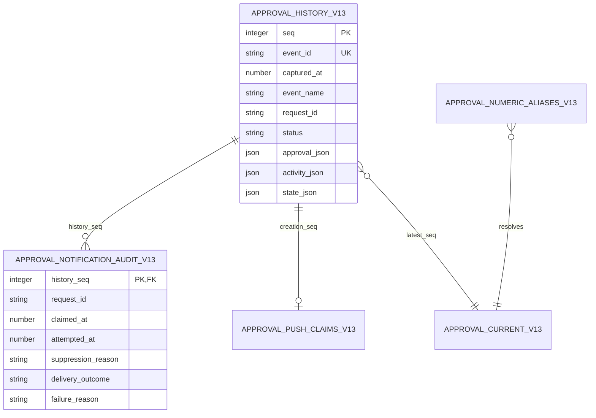

# Approvals UX v1.3.0 — bounded corrective amendment

Status: design candidate for independent Seal and Meridian bounded re-check; NOT build/release approval. Owner: Keystone. Sole issuance task: t_4cd8463b. CEO rulings on this task adopt scrub-before-persist plus egress and defer the signed-capability choice. No runtime, deployed database, plugin or dependency changes are authorized here.

This amendment supersedes conflicting v1.2 clauses in Domain/history, Replay/parity list correspondence, Redaction boundary and Creation push/audit. Unchanged v1.2 Identifier resolution, Time/atomic errors, Cutover rules, authorization, fixed seven-day expiry, bounded wait, presentation, unknown fallback, accessibility and A1–A12 remain incorporated. Its status authority is replaced by the section below. Older escalation/scheduler requirements remain superseded. Companions: approvals-ux-v1.3.0.openapi.json; approvals-attention-v1.3.0.sql; approvals-presentation-v1.3.0.schema.json; check-approvals-v1.3.0.py; approvals-v1.3.0-validation.txt.

## Status vocabulary

Canonical ordered vocabulary: `pending | approved | denied | cancelled | expired`.

### Input alias mapping

`rejected` → `denied`: legacy input only; normalize before validation, never persist or emit. Operator decision inputs accept only the two operator outcomes plus this input alias. Other values return 422.

### Lifecycle

Creation is pending; explicit authenticated operator action alone approves/denies. Cancellation is requester withdrawal or confirmed owned worker death, never a timeout/transport failure. Expiry is only requested_at+604800, with `Approval expired after 7 days without a decision.` Server finite epoch seconds govern every timestamp; local display is WIB. First committed terminal action wins; every later decision/cancellation/agent reply attempting terminal mutation returns 409 existing record, even if identical. No silent ignore, terminal overwrite or second decision event. Seen is not consent, consent is not execution, and bounded wait cannot resurrect a callback.

## 1. Adopted redaction and sole-writer boundary

The ONE shared authority is redaction-contract-v1.1.0.md §§1–2 plus appended §3 (CEO-adopted write-surface clause). Existing upstream raw source files/snapshots/reducer/cache/queues remain immutable and are not rewritten by presentation redaction. MC-owned approval text, presentation, history, state and audit are scrubbed derived persistence, not copies of raw upstream source storage. The §3 exception applies before their FIRST durable insert, including WAL, temporary DBs, compatibility projections, replay snapshots, audit and diagnostic logs. Raw credential-bearing input may exist only in the emitting process memory for the decision lifetime; it MUST NOT enter any durable staging table, request dump, cache on disk, exception, access log, trace, metric label or queue. Emitters scrub before transmission; server ingress still independently validates/scrubs. No reliance on emitter trust.

Pipeline: authenticate → parse strict JSON in memory (reject duplicate object keys, NaN/Infinity, booleans in numeric fields, unknown keys and oversized payloads) → validate typed identities without changing them → canonical shared-policy free-text scrub → validate closed schema and lifecycle → build complete state/audit → one transaction → revalidate fresh egress copy → serialize. Do not persist rejected input or raw fingerprints. At most fixed bounded error codes are logged before safe normalization. No secret-shaped identity/dynamic key may be renamed, merged or leaked: reject ingress 422 with fixed safe detail; fail unsafe historical egress with HTTP 500 fixed `Internal Server Error`, close SSE before the affected event, suppress notification. Preserve valid IDs, types, enums, metrics and timestamps exactly. If text cannot be classified safely, use the existing unknown/needs_care presentation, not raw fallback.

All API list/state/exact/wait/conflict/error branches, initial/live/replay/queued SSE snapshot/activity/approval frames, dynamic HTML, browser notification and outbound payload/log adapters cross the same policy afresh. No stored-safe exemption: policy may strengthen later. Typed selection is identical for replay and live approval adapters. Auth and configured delivery credentials go only to their intended destination, never display/audit and never redirect forwarding. Redaction precedes HTML escaping; innerHTML is not a text sanitizer.

### Mandatory executable enforcement hook

Every SQLite writer connection MUST register `mc_approval_safe_json(value, kind)` before write access; kinds are approval, state, activity and identity. This is a mandatory implementation interface, not an installed function. The function returns integer 1 only after closed-schema validation, strict finite scalar/identity checks, recursive key inspection and equality to canonical shared-policy scrubbed free-text values; otherwise returns 0 or raises a fixed non-sensitive error. It MUST NOT write/log its arguments, normalize unsafe identities, mutate raw source objects or register a permissive fallback. For stored state, schema is ApprovalState without seq/captured_at (row-owned metadata). All declared keys/required fields remain validated. SQL triggers call it for every incoming JSON artifact and event_id; a missing function fails closed. SQL cannot itself detect arbitrary credentials; annotations and CHECK(json_valid) are not proof. Database-owner arbitrary DDL/trigger removal is outside the threat boundary; no application identity gets arbitrary SQL/DDL. Direct INSERT without the hook fails; direct INSERT with the hook and unredacted text fails. No INSERT OR IGNORE, OR REPLACE or catch-and-continue on contract failures. All writer paths must use the same validating connection factory; no independent legacy writer survives cutover.

A7 remains mandatory on actual implementation: every shared-policy adversarial class, nested values/keys, invalid identities, malformed-body/error/log paths, replay/queues and all four persistence/API/SSE/notification surfaces; inspect raw bytes including DB/WAL/logs, not DOM. The design checker executes representative synthetic fixtures against the inspected scrubber and test hook, NOT full runtime canary certification. Existing shared-policy compressed IPv6/private-key/header/control gaps cannot be waived by this amendment; their runtime acceptance stays gated. Operator sees masked values intentionally. If a decision genuinely needs context, the requester must describe it in prose rather than paste a raw value.

## 2. Domain, DB immutability and state correspondence

v13 names are isolated design DDL, NOT instructions to create a second production ledger alongside a running v12. Piston must propose additive migration/backfill and rollback for the actually installed schema, never touch Hermes DBs. Immutable source ledger and audit reject every UPDATE/DELETE by trigger, including retries and same-value UPDATE. Current is a view, never mutable truth. Duplicate terminal event inserts (including semantically identical retries with new event IDs) also abort; only a real permitted telemetry transition may append after terminal state. Once terminal, every canonical Approval field is frozen EXCEPT first_seen_at (null→first server seen once) and notification (only the explicit monotone audit transitions in §4). This freezes full presentation/action text, classification, contract_version, status, request_id, requested_at, expires_at, terminal_at, decided_at/by, terminal_reason and expiry_reason. The exception is administrative telemetry, not a terminal decision field. All future action/presentation reply/revision attempts on terminal requests fail. Pending presentation revisions preserve identity/creation/deadline and may not change the authorized action; separate Q&A/action-hash contracts still govern that path.

terminal_at is a new required nullable finite server epoch field: pending null; approved/denied equals decided_at; expired equals expires_at; cancelled equals first cancellation commit captured_at. It never changes on seen/audit. Nondecision statuses have null decided_at/by; noncancelled terminal_reason is null. Captures never regress. DB compares full terminal payloads semantically excluding only the two telemetry fields, not just status. A same-status replacement changing decided_by/reason/detail is rejected. Direct UPDATE on a decided ledger row is rejected even if no new event is appended.

Each stored state_json is EXACTLY the canonical bounded state derived from latest ledger records at that row, BEFORE read-time expiry overlay, without seq/captured_at. AFTER INSERT trigger recomputes the snapshot view, compares both json_tree directions including key/type/value/array position, and aborts the whole statement/transaction if not equal. `{}` snapshots, missing/extra/duplicate records, stale notification copies and divergent presentation cannot commit. Approval projection, generated audit, consumed creation claim and snapshot commit atomically. seq/captured_at are injected from the ledger row at read time, never accepted from client snapshots. Transient AFTER-trigger work remains transaction-local and rollback-safe.

## 3. Read contracts, pagination and replay

“Current” has exactly one meaning: latest durable approval event per request_id at pinned ledger seq S; it does not mean pending-only or UI history. Read-time expiry overlay is applied at captured read time T to pending deadlines; overlay does not create a seq. Historical replay uses original captured_at, not present time. A later write-capable lifecycle access materializes expiry first. Equality claims compare the same S and T.

- `GET /v1/approvals` is a PAGE of current records across all statuses by default, response `{seq,captured_at,items,next_cursor}`. limit default 100, maximum 200, minimum 1; no uncapped mode. Optional status is all or a canonical status, evaluated AFTER overlay. Sort by each record's latest row seq ascending (globally unique, no tie ambiguity). Page 1 pins S and T. Continuation cursor is base64url without padding of strict UTF-8 JSON `{v:1,seq:S,at:T,after:A,status:F,limit:L}` with exactly these fields. A is last returned latest row seq, initially 0. Cursor is opaque to clients, carries no authority and is fully validated server-side against existing seq/ranges, finite T, allowed filter and L; later pages cannot change L/F (mismatch 422). Select latest per request at seq<=S, overlay at T, filter, seek row seq>A, return L and cursor only if more rows. Malformed/duplicate query parameters 422; no longer available pinned history 409 cursor_unavailable with reset instruction. Reauthorize each page. A cursor never grants access to records hidden by auth.
- `GET /v1/approvals/{identifier}` returns ONE canonical Approval in any status without a history-array cap; “uncapped exact” means lookup reachability, never unbounded collection. Shared resolver/auth/409/422 rules survive unchanged. Detail/wait and conflict records match this representation.
- `GET /v1/state.approval_state` and SSE snapshot.data are the SAME bounded ApprovalState `{seq,captured_at,approvals,approval_history,pending_truncated}`. approvals = oldest 100 durable pending rows by requested_at asc, request_id asc; history = newest 100 durable terminal rows by terminal_at desc, request_id asc. pending_truncated reports durable pending count>100. Read overlay converts overdue pending entries to terminal, merges/sorts these with history, then limits each array again; it never fabricates notification or decision. Overlay operates on all latest records at S, not merely the capped input, so expired rows beyond the pending cap cannot be lost. The per-event stored state is the pre-overlay bounded view; uncapped latest ledger rows are the source for a fresh live overlay. Historical stored snapshot replay is at its original capture clock and must use the same full-ledger-at-S reconstruction if overlay is needed. The UI must expose truncation and use paginated list for complete review; hidden pending rows remain reachable and ingested. Snapshot is not the list PAGE. This explicitly replaces v1.2's list/snapshot equality claim; equality remains state↔snapshot and exact↔approval event at the same S/T.
- Global AUTOINCREMENT seq, names snapshot/activity/approval, full replacement approval events, complete ordered replay, atomic replay→tail watermark, seq dedupe and no replay notification remain unchanged. Last-Event-ID is canonical decimal; unknown/missing/future cursor 409 before stream with JSON error, malformed 422 before stream. Once SSE is open, do not emit JSON errors as frames. Close safely before a bad frame. Snapshot replay retains original event data and capture time; no reordering or selective skipping.
- Only methods explicitly in OpenAPI exist within this profile; unsupported method 405 with Allow. Request bodies require application/json (415 otherwise). New history export is the local ingestion view in §5, NOT an unapproved network endpoint. Signed-path behavior is not implied by method closure in this unsigned profile.

## 4. Notification audit and runtime guarantees

One creation-time push to the existing configured destination. No retries, delayed dispatch, restart resend, catch-up, scheduler, cron, periodic poll or sweep. At-most-once attempt is NOT exactly-once remote delivery. The in-MC badge/banner is fallback after loss. Browser opt-in notification and outbound destination each dedupe on request_id; persisted delivery_outcome here refers to configured outbound transport, not proof the human saw it. Browser delivery/permission/quiet tests remain separate acceptance.

Creation atomically records the immutable request_id claim and initial notification `{claimed_at,attempted_at:null,suppression_reason:null,delivery_outcome:null,failure_reason:null}`. claimed_at is server acceptance/capture time; the claim is never released. Duplicate creation/other event ID/replay/import cannot produce a new claim/send. A dispatch closure is created only by the successful original live creation transaction; persisted claims are NEVER restart work items.

Per request, an immutable audit row is automatically generated for every distinct notification stage from its full approval history row; first row is claimed. Audit columns are distinct and DB-constrained. Its source history_seq is unique and all values must match that source record. Permitted transitions only:

| From | To | Required fields |
|---|---|---|
| claimed | suppressed | attempted_at null; suppression_reason quiet_hours, unconfigured or already_terminal; outcome/failure null |
| claimed | attempted | attempted_at>=claimed_at; suppression/outcome/failure null; this transaction commits BEFORE the single network call |
| claimed | failed without attempt | attempted_at null; outcome failed; failure_reason crash_before_attempt; suppression null |
| attempted | sent | same attempted_at; outcome sent; suppression/failure null |
| attempted | failed | same attempted_at; outcome failed; failure_reason transport_error, timeout or uncertain_delivery; suppression null |

No transition after suppressed/sent/failed; claimed_at and any attempted_at cannot change; no second attempt. Immutable audit rows reject UPDATE/DELETE. The SQL hook validates exhaustive legal field combinations and the audit trigger rejects reset/rewrite and terminal-stage changes. A delayed network RESULT may append telemetry after a decision but cannot change any terminal action field; a NEW attempt after terminal state is forbidden. Dispatch eligibility check and attempt reservation must serialize with terminal decisions under one SQLite write transaction. If terminal wins, suppress already_terminal. If attempt wins, it may already be in flight when decision commits; no claim of remote cancellation or impossibility of later network arrival is made. Never hold DB lock during I/O.

Persisted quiet config remains Asia/Jakarta 23:00–06:00; read at creation and immediately before reservation. Either quiet suppresses push/sound with reason quiet_hours; silent page attention persists. Missing/invalid config fails closed to these defaults with fixed diagnostic. Missing destination suppresses unconfigured. Config revision authorization/audit remains v1.2. No 06:00 catch-up.

Failure windows: crash after claim before attempt loses push permanently; crash after attempt commit before I/O also loses push; crash after remote receipt before result is uncertain, never sent by inference. No global startup recovery sweep. On the next ALREADY REQUIRED request-specific write-capable lifecycle access, append crash_before_attempt for an orphaned claim or uncertain_delivery for an orphaned attempt, after proving creator process instance is dead; never dispatch. Until materialized, null outcome means unresolved/unknown, MUST be displayed as such, never sent/success. This replaces v1.2's ambiguous blanket “on restart recorded failed” with a no-sweep request-local reconciliation rule. Owner display/seen may use its existing write route; GET remains read-only. Tests must inject all crash points, concurrent dispatchers and terminal races; actual outbound capture and configured destination/operator confirmation remain required, not fabricated by isolated DDL tests.

## 5. Bronze source contract, checkpoint and 10× growth

Owner split: Keystone owns source contract; Cask alone ingests Bronze; Meridian owns Silver conformance/history; Prism consumes Gold. Source is an explicit read-only local export of all immutable approval_history_v13 rows ordered seq, including activity/snapshot and all cancellation/expiry records, not UI caps. Stable `_source` is `mission_control.approval_history.v1.3`; source_instance_id is a persisted UUID generated once at original store initialization and preserved on backup/restore/archives, never regenerated at restart. source_epoch is a new UUID ONLY for an explicitly governed divergent restore/fork; restoring a prior high-water without changing epoch and consumer reconciliation is forbidden.

Bronze `mc_approval_event_cdc` grain: one exact safe source ledger row per `(source_instance_id,source_epoch,seq)`. Exact source columns: seq,event_id,captured_at,event_name,request_id,status,approval_json,activity_json,state_json. Preserve their values/bytes without warehouse re-redaction/transformation; “raw Bronze” means exact already-scrubbed source, never reinserting upstream credentials. Metadata columns: `_source` string, source_instance_id UUID, source_epoch UUID, `_ingested_at` finite ingestion epoch seconds, ingestion_run_id UUID, source_high_water integer, contract_version `1.3.0`. Event_id is unique within source epoch and retained as lineage, not substituted for seq. Audit export `mc_approval_notification_cdc` preserves exact immutable audit columns, joins via history_seq, same source metadata and key `(instance,epoch,history_seq)`. Claims/aliases may be separate additive governed exports, never inferred from bounded state.

Each run opens a source read snapshot and pins high-water H. Read `seq>C AND seq<=H ORDER BY seq LIMIT 1000` from durable local source, checkpoint C only AFTER corresponding Bronze rows and audit rows are durable and verified. Store per-source/epoch checkpoint `(last_seq,last_event_id,last_row_sha256,run_id,committed_at,H)` atomically with ingest-manifest commit or durable recoverable equivalent. Hash exact safe source-column UTF-8 JSON in declared column order with compact JSON, no PII/raw arguments. If lakehouse cannot atomically commit checkpoint and data, persist manifest AFTER data: restart rereads same range and validates key+source-byte hash, suppressing identical duplicates BEFORE append; differing content under same key quarantines the safe row and halts, never overwrites. Gaps in AUTOINCREMENT are allowed; watermark is committed seq, not count or captured_at. Never checkpoint MAX fetched before durable write. Replay/bootstrap from C=0 ignores UI cap. A fork/rollback or hash mismatch blocks ingestion pending explicit reconciliation. Source rows have no ingestion timestamps added in place; metadata belongs to Bronze.

Full state per event remains intentional for deterministic replay; we do NOT silently switch to deltas or delete history. v1.3 bounds persisted snapshot arrays to 100+100 and canonical Approval serialized UTF-8 to <=8192 bytes, Activity <=2048, event_id<=128 ASCII bytes; state_json <=1700000 bytes and request body <=1048576 bytes, rejecting oversized inputs atomically 422 before DB persistence. Presentation text detail max4096 characters AND whole-record byte cap applies after scrub/normalization; unknown dynamic payloads are forbidden. Complete list/history still lives in per-request event rows. This changes storage growth from unbounded O(E×current-size) to bounded O(E×200×8KiB); it does not remove SQLite serialization/WAL costs.

Capacity envelope (planning bound, NOT measured throughput): <=1720000 logical payload bytes/event including full approval+activity+state+IDs; at baseline 1000 events/day ~1.72 GB/day decimal, 10×=10000/day ~17.2 GB/day, 30 days ~516 GB logical before indexes/WAL/backup. Snapshot-heavy storage can be unacceptable even at that rate; no claim of 10× production readiness is made. Before production at 10×, Piston/Relay must benchmark target disks with this worst-size fixture, concurrent reads/writes, p95 write commit <=250ms and no dropped/reordered replay, record WAL/backup growth, and demonstrate free space for 30 days plus measured overhead and two full backups. Failing any gate blocks deployment and requires authorized revised storage design, not dropping records/caps silently.

Non-destructive archive plan within frozen no-delete policy: create immutable backup/export partitions by source_instance/epoch and seq ranges (target 100000 events/shard, manifests also include capture-day ranges); each manifest records min/max seq, actual row count (gaps allowed), ordered source-byte hash, schema/version and audit hash. Copy under source read snapshot, independently read back full shard and compare per-key hashes/counts before marking archive verified. Keep every local ledger row and replay cursor valid; do NOT DELETE/VACUUM/compact source ledger or expire Last-Event-ID as a hidden retention change. Backup/shard creation is a separately authorized operational job, NOT notification work and not performed here. Restore into an isolated store, replay C=0 through H, verify snapshot/exact/audit parity, then allow disaster-recovery promotion only with authorized source-epoch/checkpoint disposition. This preserves replay and ingestion without requiring a new approved online archive routing design. Physical tiering/deletion/delta compaction needs future CEO+Seal+Meridian sign-off; until then provision capacity or stop acceptance before exhaustion. Local insertion capacity guard must fail atomically with fixed 503 `{"detail":"Approval storage capacity unavailable"}` and alert before disk reserve is breached, never truncate history. This is a bounded growth and lossless archival contract, not approval of a new infrastructure dependency.

## 6. Signed-capability adapter

PENDING — section intentionally absent.

PENDING OPERATOR DECISION — section intentionally absent. Neither retain/harden nor retire is selected or designed. Existing authority paths are not silently changed. This is a documented OPEN blocker, not a claim all endpoint contracts are final. One bounded amendment after Randy's decision must specify the sole chosen adapter/retirement path and receive required independent review. Approvals implementation/build t_2434c6c7 stays gated; neither this candidate issuance nor a bounded pass on other sections releases it.

## 7. Changelog and blocker disposition

| Finding | Resolution / exact scope |
|---|---|
| Seal redaction-before-persist, errors/logs/key/identifier and four surfaces | §1 + shared §3 adopt dual boundary; required per-connection fail-closed SQL hook and explicit canary matrix. Representative isolated hook tests only; actual A7 stays runtime gate. |
| Seal/Meridian same-status terminal tampering and direct UPDATE | §2 freezes every nontelemetry canonical field in DB; direct UPDATE/DELETE always abort; executable per-terminal fixtures. |
| Seal state_json correspondence | §2 AFTER INSERT symmetric typed-tree comparison against recomputed full bounded view; stale/missing/extra state rejects. |
| Seal notification audit/outcome/crash guarantee; Meridian incompatible fields | §4 distinct immutable audit columns/monotone transitions, no retry/sweep, explicit unknown/loss and race semantics; exhaustive presentation oneOf and DDL guard. |
| Meridian uncapped/current/list/exact ambiguity | §3 current defined once; stable seq-pinned default100/max200 cursor page separate from bounded state; typed OpenAPI. |
| Meridian method/content-type/pre-stream errors | §3/OpenAPI 405 Allow,415 JSON-only and pre-stream JSON vs close-after-open distinction. |
| Meridian Bronze lineage/checkpoint/idempotency and 10× | §5 exact source-grain exports, metadata, verified checkpoint/replay; byte bounds, numeric envelope, performance/capacity gates, non-destructive archive/restore. Review/production benchmark still required. |
| Meridian signed adapter | §6 intentionally absent per explicit CEO ruling. OPEN operator amendment gate; not downgraded to non-blocking. |

Trade-offs: write+egress scrub intentionally masks operator-visible values; fail-closed hook/schema checks add CPU/availability risk. Full snapshots remain bounded but expensive and single-writer SQLite latency must be measured. Seq-pinned pages preserve consistency over fresh results; clients refresh page1 for latest. At-most-once notification deliberately loses deliveries and cannot prove human receipt. Archives copy rather than reclaim storage; deletion requires a separately approved architecture change.

## 8. Verification and release gate

Checker evidence is artifact parity, local-ref/schema consistency, isolated SQLite direct-tamper/state/audit/rollback tests and representative safety-hook fixtures only. No installed migration, API/SSE/UI/Discord runtime, compressed IPv6/PEM complete-policy acceptance or throughput benchmark is certified. A1–A12 from v1.2 remain required, with A6 list/state parity replaced only as explicitly specified in §3. Add: tamper each terminal field for all four terminal statuses; telemetry-only valid updates; bad snapshot rollback including generated claim/audit; notification contradictory schema/DB states, duplicate attempt/outcome, quiet boundaries, process death and late result; cursor pinning/no lost concurrent updates; >100 pending visibility; Bronze crash-before-checkpoint/dedupe/fork; 10× capacity/restore fixture.

Route only changed §§1–5/7–8 and companion diffs to Seal and Meridian; Meridian additionally reviews shared redaction §3 only, preserving approved §§1–2. Kestrel consolidates bounded verdicts. No changes to signed-path runtime are implied, no old PASS is blanket v1.3 approval. Keep real graph dependencies on both independent reviews and signed-policy gate before build. Negative review cards may complete as evidence but cannot authorize build; explicit verdict and operator amendment are mandatory.
