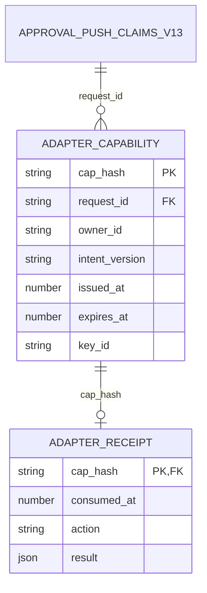

# Approvals v1.3.0 §6 — Option A additive amendment, revision 1

Status: ISSUED DESIGN CANDIDATE, NOT APPROVED. Sole contract owner: Keystone, t_4b9e93ef. Independent reviewer: Seal, t_8e2070ab. Authority: CEO t_861cf00f Option A ruling and approvals-v1.3.0-ceo-disposition.md §3. This is the ONE bounded §6 amendment, not a competing approvals architecture. No implementation, build, deployment, publication or runtime acceptance is authorized.

## Scope and precedence

Read this document as the replacement content of §6 of approvals-ux-v1.3.0-amendment.md. The original file is deliberately NOT edited. Its §6 pending statements, the signed hold annotation in its OpenAPI and references to that pending choice in its introduction/§7/§8 are historical: only their assertion that the operator choice/design is absent is superseded here. All independent-review/release holds remain. Every byte of §§1–5/7–8 remains unchanged, including all limits. No change to the existing unsigned OpenAPI paths, approval schema, SQL ledger, notification lifecycle, pagination, Bronze source, checkpoint, archive, upstream raw immutability or shared dual scrub policy. The old seven hashes are insufficient for approval of this resulting expanded set.

Enumerated additions ONLY:
1. This §6 amendment document.
2. approvals-v1.3.0-section6-option-a.openapi.json: isolated additive browser adapter paths and logical private storage schemas. Not a replacement for the base OpenAPI. No new SQL DDL or changes to existing objects.
3. check-approvals-v1.3.0-section6.py: offline contract/observation assertions and negative fixtures; no server implementation.
4. approvals-v1.3.0-section6-validation.txt: actual checker run output, exit codes and rejection count.
5. approvals-v1.3.0-section6-hashes.json: resulting exact artifact set, including the seven frozen files and CEO authority. The manifest excludes itself to avoid a recursive hash; its own exact SHA-256 is recorded in the handoff/readback receipt.
6. approvals-v1.3.0-section6-vault-readback.json: transport/readback evidence for the set plus manifest; its own hash is recorded in the handoff. This evidence file is mirrored and read back separately, not recursively listed inside itself.

## 6.1 Domain and invariants (before API)

These are logical private source schemas, not installed tables/migration instructions. Persist under the SAME SQLite transaction boundary as the approval ledger and, when available, the already-reviewed conversation append. Piston must supply the installed-schema migration/rollback in implementation review. Do not create another approval truth table. cap_hash is lowercase SHA-256 of the ASCII capability reference; it is the only persisted capability identity, including indexes, backups, WAL and receipts. No raw/reversibly encrypted capability reference, signature, CSRF token, request body, owner credential or signing key in any row. Keys are existing server-managed credentials referenced by key_id, never schema data. Access is server-only, not in API/SSE/notification audit/Bronze exports. Existing source exports remain byte/grain unchanged; no new data-team ingestion is authorized. Receipt result contains only canonical freshly scrubbed approval and optional conversation question_seq, no security material. Immutable capability rows and one immutable receipt per cap_hash; no UPDATE/DELETE or replacement-upsert; uniqueness enforces consumption. Retain receipts and capability hash records with the corresponding immutable approval record so authentic replay can return 409 after TTL; this is not an authority-lifetime extension.

Creation-time dispatch may mint ONE reference for the already-authorized owner and immutable request/action intent, only as part of the original live creation closure. No retries, restart resend, scheduler, sweep, background refresh, new push or renewal endpoint. Persist the hashed record before dispatch. A failed push may lose that reference permanently. The existing authenticated in-MC routes remain the fallback after five minutes or failed delivery; approval expiry remains seven days. Never regenerate the reference from storage. No mutation of existing notification claim/audit semantics. A capability is sensitive routing data but NOT sufficient authority: owner authentication and fresh scope checks are required independently. A forwarded link never authenticates its recipient or selects decided_by.

Reference: 32 CSPRNG bytes, unpadded base64url (43 characters, final character must encode canonical trailing bits); strict decode/re-encode identity check. issued_at and expires_at are finite server epoch seconds, 0 < expires_at-issued_at <= 300, never beyond approval.expires_at. Authority is live only when issued_at <= now < expires_at; exactly the expiry boundary rejects. intent_version is a SHA-256 digest of the existing authoritative immutable action identity plus pending presentation revision; do not hash raw credential-bearing commands into a durable record. If no reviewed safe intent identity/revision is available, minting fails closed. Changing action or presentation invalidates submission (409 stale_intent, no consumption); a terminal approval conflicts, never resurrects or mutates.

## 6.2 API and signature/CSRF protocol

Delivered URL is exactly `https://<configured MC origin>/approval-capabilities/<reference>`: no query, fragment, action, signature, key, credential, or embedded authorization. Origin must be configured HTTPS, never derived from Host/forwarded headers. All three buttons share this card, not signed/action-specific links. No third-party resources, link previews performing decisions, redirects containing security material, browser URL/history/localStorage/sessionStorage/service-worker persistence of signature or CSRF. Disable automatic submission. No signature is permitted in any URL anywhere in the adapter, including encoded query/path and error/redirect links. Legacy signed GET/POST handlers for approve/deny/ask must be disabled at cutover: fail closed with 410 fixed retired_route, no redirect, no write. This explicitly supersedes HEAD server/discord.py::_decision_url; the CEO ruling, not the redaction contract, resolves the choice. Existing bearer-only API routes are unchanged and must not accept URL signatures as substitute auth.

GET /approval-capabilities/{reference}: authenticate existing owner transport before lookup (no credential in URL), authorize owner_id and request scope, validate reference/hash and TTL, read current scrubbed approval; 200 text/html. GET NEVER writes business/security storage, consumes, materializes expiry, marks seen, appends a question, or dispatches. HEAD is 405 Allow: GET. Every card/error response has Referrer-Policy: no-referrer and Cache-Control: no-store; card also Content-Security-Policy: default-src 'none'; script-src 'self'; style-src 'self'; connect-src 'self'; form-action 'self'; frame-ancestors 'none'; base-uri 'none'. Scripts/styles are same-origin static assets, no inline execution. Require existing authenticated owner context; missing401, wrong owner/scope403, unknown/malformed reference404, expired unconsumed410. Consumed authenticated GET renders read-only existing result, without usable action signature; it never refreshes TTL.

For live cards only, server generates three action-specific signatures in response memory, rendered as non-URL form data. Signature = lowercase hex HMAC-SHA256 using key_id over compact UTF-8 JSON array `["mc-option-a-v1",cap_hash,request_id,owner_id,intent_version,issued_at,expires_at,action]` with no spaces, ensure_ascii=true, finite numeric values as stored. Actions exactly approve|deny|ask; no alias or lifecycle enum extension. Signing keys and original reference never enter HTML except reference in the form endpoint. Signature is never sufficient alone. Server derives canonical tuple again from record, verifies with hmac.compare_digest (or audited constant-time equivalent) over fixed-length 32-byte decoded MACs; do not use ordinary equality, timing thresholds as proof, or cached browser validation.

CSRF double-submit: derive token as hex HMAC-SHA256 with a SEPARATE server CSRF key over compact UTF-8 JSON `["mc-option-a-csrf-v1",cap_hash,owner_id,issued_at,expires_at]`. Deliver token in hidden form data and a host-only cookie named `__Host-mc-csrf-<cap_hash>`; attributes Secure; HttpOnly; SameSite=Strict; Path=/; no Domain; Max-Age <= remaining TTL. GET sets this cookie only, no DB write. POST requires BOTH cookie and body token, constant-time equality and server re-computation against THIS cap_hash and authenticated owner. Reject copied matching cookie/body from a different capability. Reject duplicate cookie name/JSON keys and extra body keys, invalid sizes, malformed hex. Require Origin exactly configured origin and Sec-Fetch-Site same-origin (missing/cross-origin403); no permissive CORS. These checks complement, not replace, owner auth.

POST /approval-capabilities/{reference}/decision: application/json only; body exactly `{action,signature,csrf_token,payload}`. Approve/deny payload is `{}`. Ask payload is exactly `{question,client_message_id}` using existing conversation question bounds (nonblank, <=8000 Unicode characters, UUID client key; pre-persistence shared scrub). Body <=64KiB. No action/signature/token query parameters accepted; any query is422 before body processing and stripped from logs. Signature fields accepted only in body, never header/path/query/cookie. Cookie carries only CSRF. Browser explicit submit serializes JSON, never navigates to a signed URL. Missing/invalid identity401; insufficient scope403; invalid MAC/CSRF/origin403 fixed authorization_failed; content type415; invalid closed body422; too large413; capacity unavailable503 per frozen contract. Failed checks never consume or write partial action/audit records. Error bodies never echo input/security material.

After auth, shape, hash lookup, origin, signature and CSRF validation: acquire BEGIN IMMEDIATE; re-read cap and approval, compare safe intent_version, check receipt first. For a consumed cap, return409 `{code:"capability_used",existing:<stored result>}` freshly revalidated/scrubbed, no new event, even for different valid requested action and even after TTL. Authenticate/validate MAC+CSRF before revealing a receipt; TTL does not prevent authenticated replay lookup. Then for unconsumed caps enforce TTL and current pending lifecycle/deadline; expired cap410, terminal approval409 with existing canonical record, stale_intent409; no consumption. Approve/deny invoke SAME existing atomic decision path (map approve→approved, deny→denied) and insert receipt in same transaction; 200 result. Ask invokes SAME reviewed conversation question append, keeps pending, no grant, no worker unblock, no expiry extension; 201 result with question_seq. Until that separately gated conversation path is implemented/approved, ask returns503 feature_unavailable without receipt/question/consumption; this amendment does not release that build or invent wake/retry behavior. No network I/O while DB lock is held. Crash before commit rolls back BOTH effect and receipt; crash after commit returns409 on retry. Concurrent submits: one200/201, all later authenticated valid submits409 existing result. New questions after consumption use the existing owner-authenticated conversation path, not reference reuse. A receipt of ask is an existing submitted action, not a fabricated terminal decision.

## 6.3 Testable Option A observables

| ID | Constraint / fixture assertion (design checker + mandatory implementation evidence) |
|---|---|
| A01 | Capture delivered URL and every form action, redirect/error URL for approve/deny/ask: only reference allowed; reject query/path signatures and action-specific signed legacy routes410 with zero writes. |
| A02 | Strict base64url reference roundtrip, 32 decoded random bytes; URL contains only configured origin/card path/reference. GET renders200 and storage/event/notification counts unchanged. Repeated GET does not extend expiry. |
| A03 | POST JSON has signature in body only; tamper action/request/owner/intent/key/expiry MAC tuple→403 and zero writes; server recomputes from record, never trusts body identity. Signature injection in path/query never authorizes. |
| A04 | GET/HEAD/PUT decision endpoint→405 Allow: POST and zero writes; card GET read-only; explicit POST only can commit. Legacy GET decisions410, zero writes. |
| A05 | Missing or unequal cookie/body→403; matching token pair from another cap→403; absent/wrong Origin or Sec-Fetch-Site→403; cookie exact host flags; valid pair binds cap hash AND owner. |
| A06 | TTL>300 rejected at mint; now==expires_at410 for unused cap; now<issued_at410; fixed-length MAC validation calls constant-time comparator (instrumented spy plus source inspection, not elapsed-time inference). Race/crash fixture proves unique atomic consumption. |
| A07 | Valid authenticated replay after successful approve, deny OR ask returns409 with identical stored action result (fresh egress scrub), no added decision/message/receipt or altered original decision, including after TTL and competing action. |
| A08 | Card/error header exactly Referrer-Policy: no-referrer; Cache-Control: no-store. Inject query canary and raw-reference/body/security sentinels: access/error/exception/trace logs contain no query string, reference, signature, CSRF, body or auth credential. Access path is route template, not concrete reference. |
| A09 | Inspect every persistent row/index/WAL/backup/export: reference only as 64-hex SHA-256 cap_hash, never raw/base64/encrypted reversible token; stored schema disallows signature/CSRF/keys; private registry/receipt excluded from API/SSE/Bronze. |
| A10 | Configuration/route registry and outbound capture show old _decision_url signed behavior disabled; all three buttons use this adapter; no edits or approval needed from redaction contract to select Option A. No build authority derived from this issuance. |

Logs MUST strip the complete query before ANY application logger/middleware/exception request formatting; all capability path segments replaced with route templates. Do not log request bodies or cookie/auth values, even on malformed JSON. Proxy/access-log setup is an implementation acceptance prerequisite too; no deployment while an upstream logger leaks references or query values. Redaction still runs before first durable MC-owned derived text write and at every egress; this protocol material is omitted rather than persisted then scrubbed. Upstream raw sources unchanged. No new notification retries/scheduler/sweep.

## Verification, data boundary and remaining gates

Checker is a static contract/schema consistency and synthetic observation-fixture checker, NOT a running adapter, full OpenAPI meta-validator, constant-time certification or DB migration. It runs the frozen checker unchanged and verifies all seven original hashes, proving the ENTIRE original prose (stronger than §§1–5/7–8) is unmodified. Negative observation mutations have an exact expected rejection count. Piston must replace synthetic observations with instrumented real handler/browser/DB/WAL/log/transport evidence for A01–A10, including race/crash and comparator spy. A1–A12, A7 runtime security, pagination, Bronze consumer, capacity/restore and Meridian readiness remain unproven.

Meridian's reviewed §3 reads/pagination and §4 notification lifecycle/API/DB surfaces are untouched; no conditional re-review of those surfaces is triggered by their modification. These new private adapter schemas are isolated additions with no ingestion export; Seal/CEO should route Meridian if they determine a data-interface impact beyond this stated boundary. Trade-offs: separate owner authentication prevents forwarded routing links granting authority; five-minute links lose convenience intentionally; hashed-only storage prevents resend/reconstruction; serial commit chooses consistency over latency; keeping immutable receipts permits replay evidence but costs storage. No measured performance claim.

Seal must review this exact resulting hash set independently. CEO exact-set disposition at t_18d27b47 and Randy's explicit go-ahead remain required; completion of t_4b9e93ef is issuance only. Retained bounded-hook review is separate and untouched. Producer Keystone; independent review pending, not self-reviewed.
