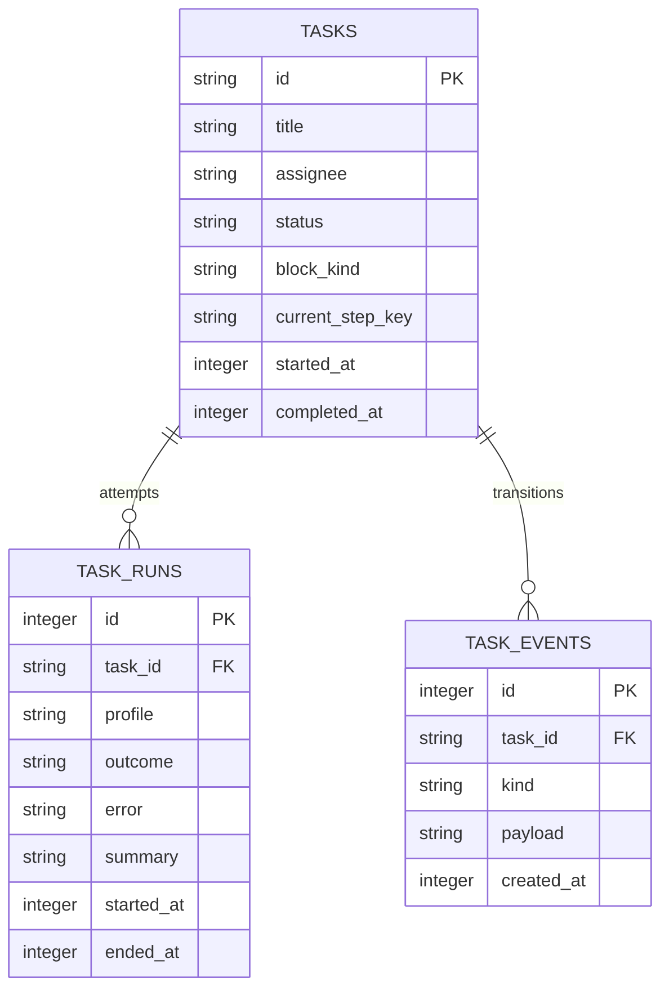

# MC KPI drill-down contract v1.0.0

Status: candidate; Keystone owns domain/API decisions, Meridian validates data semantics before Piston builds. Scope: additive read-only MC projection and KPI UI only. No new dependencies, board migrations, Kanban semantics changes, deployment or publishing. Pipeline panel and its projection remain untouched. Implement only in `/opt/data/hermes-mission-control/`, never `/opt/hermes`.

## 1. Domain and source mapping

Projection grain: one task per category, not one run. A task may legitimately occur in both Failed and Blocked; counts are not a partition. Runtime attempts and current lifecycle state are distinct dimensions. Archived is never in any category even if block_kind is stale. Running: status exactly `running`. Done: status exactly `done`. Blocked: status exactly `blocked`, never merely a nonnull block_kind. Failed: status neither `done` nor `archived`, and latest run's outcome in `crashed,gave_up,timed_out,failed,rate_limited`. Latest means greatest task_runs.id for that task, INCLUDING open runs with null outcome; never select only finished/failed runs. This keeps an active retry from appearing as a stale failure. Do not use consecutive_failures as the classification rule.

`attempts` = count of ALL task_runs for the task. `outcome_attempts` = count of runs with the latest outcome over all history. Render `crashed ×6 · 11 attempts` for the supplied example, not `crashed ×11`. Missing latest outcome => null; never invent a failure. Assignee = tasks.assignee (nullable); `profile` = latest run profile (nullable), not a substitute for ownership. Show Unassigned for missing assignee.

Failed timestamp = latest run ended_at. Running start = latest run started_at, fallback tasks.started_at; elapsed = max(0, now-start). Done time = tasks.completed_at, fallback latest ended_at ONLY if latest outcome completed. Blocked time = latest blocked event created_at. Preserve null/unknown timestamps, show `time unavailable`, never epoch or current time. Current step = tasks.current_step_key, fallback latest step_key, otherwise null (UI omits it).

Failure reason = exact latest error text; null/empty/whitespace displays `no reason recorded`, not summary-as-error. Blocked kind maps tasks.block_kind to public `blocked_kind`; valid kinds needs_input/dependency/capability/transient. Missing/unknown kind remains visible as unknown (raw value retained), not needs_input. Block reason = reason from the latest `task_events.kind='blocked'` JSON payload by id for a currently blocked task. No tasks.block_reason column exists. Missing/malformed payload => `no reason recorded`, never an old run error presented as the block reason. Summaries are not machine-classification inputs.

## 2. Retention, count identity and cap resolution

No implicit seven-day filter: current broken/blocked/running tasks must remain visible even if older. Done is current done status over all board history. Empty messages: `Nothing failed on this board.`, `No blocked tasks on this board.`, `No running tasks on this board.`, `No completed tasks on this board.` Do not claim a time window not applied.

Each category independently sorts descending by its timestamp (null last), then task_id ascending, and returns its first 20 unique tasks. `count` = rows.length, `total` = full qualifying distinct tasks, `omitted` = total-count. Tile's PRIMARY number is count, so literal tile-number/list-length equality always holds even with >20 tasks. Show a mandatory subtitle e.g. `20 shown of 27 · 7 omitted` when omitted>0; otherwise `All 8 tasks`. Panel repeats it. This is an explicit bounded-list metric, not a misleading full total. Do not show total=27 on a tile that drills into 20 rows. Existing legacy kpis.tasks_running/done/blocked/failed become full qualifying totals from this same snapshot (failure semantics corrected as requested), while clickable tiles use task_filters.categories[category].count. Document this distinction in tests. Keep unrelated legacy KPI keys intact.

`failures` is an additive compatibility alias of the exact failed category rows, never a separately queried list. `failures_omitted` aliases its omitted. On source error count/total/omitted and legacy affected task KPI counts are null, not zero; rows=[] and failures=[], failures_omitted=null. UI shows `—` / `board unavailable` and reason, never a healthy zero or old data as current. Success rate uses full Done/(Done+Failed) totals, not attempts and not capped lengths. Format to one decimal percent; null when denominator zero/unavailable. This is explicitly `Resolved-task success rate`, not historical worker-attempt success. Its button opens Done (aria-label includes `Show completed tasks; rate based on D done and F failed`). Tasks completed aliases Done; its primary count is the same bounded Done count with the same subtitle. The rate is a percentage, not a list count; accessible help names numerator/denominator. Monetary/token/agent tiles remain unchanged.

## 3. API and consistency

Add task_filters, failures, failures_omitted, failures_error to authenticated GET /v1/state; no new endpoint required. See adjacent OpenAPI JSON for normative shape. All times are epoch seconds in transport. UI always explicitly formats Asia/Jakarta (WIB) with year, date, hours/minutes/seconds, independent of browser timezone. generated_at is snapshot capture time; no locale-specific strings in API.

Read tasks, task_runs and blocked task_events in ONE read transaction using a fresh `mode=ro` URI connection, query_only=ON, 200ms timeout, explicit BEGIN, close in finally. Use configured MC_KANBAN_DB (current default /opt/data/kanban.db), not profile-relative ~/.hermes. Rank runs before joining to tasks; aggregate attempts separately to avoid event fanout inflation. Derive category membership, sorted rows, counts, legacy KPI task totals and aliases from that single materialized projection. Avoid the existing independent reduce_tasks query for these counts; preserve old tasks fields needed by other panels. Do not edit pipeline.py or renderPipeline. No board writes/CREATE/UPDATE/DELETE/WAL configuration; never attach writable board. No live cache invalidation dependency is required: recompute on every /v1/state reduction, same delivery refresh cadence as existing state. Do not introduce a new polling loop.

Local degradation boundary: absent board, timeout, missing required schema, malformed core data => unavailable task_filters and safe fixed failures_error `board unavailable: read_error|schema_mismatch|busy`; avoid raw OS paths/SQL/secrets. Missing optional step info or malformed block-event JSON degrades that row only. No change to unrelated state sections or pipeline availability. State remains HTTP 200 when just this projection is unavailable; existing authentication unchanged.

## 4. UI behavior

Expose Running, Done, Failed, Blocked buttons together in the existing KPI/queue summary region and make Tasks completed / Success rate aliases interactive. Native type=button, aria-pressed on every alias, aria-controls=taskFilterPanel; visible keyboard focus. Active category lives in hash parameter `taskFilter=running|done|failed|blocked`. Preserve unrelated hash parameters; handle hashchange, initial load, refresh, and browser Back/Forward. Unknown category removes only taskFilter and leaves default view. Clicking active tile or Clear removes taskFilter and restores normal view. Do not hide or rewrite pipeline/default unrelated panels; show the new dedicated list below KPI region only while active. Atomic render from one state object; do not blend prior rows and new counts during SSE updates. Re-render preserves focus and expanded reason keyed by task_id + latest_run_id; no duplicated event handlers.

Each row: task id in selectable monospace text plus keyboard Copy ID button (clipboard rejection gives selectable ID fallback); title; assignee; latest outcome (or `no run recorded`); both attempts and outcome_attempts; status; correct category timestamp; reason. Blocked additionally displays blocked_kind and block reason. Running additionally displays start, elapsed and available step. Done displays completion. Outcome and block reason are separately labelled on overlapping rows.

Reason preview = first nonempty line, clipped through first `.`, `!` or `?` followed by whitespace/end, or whole line if none; if over 240 characters show first 240 + ellipsis. Expand button reveals the ENTIRE preserved source string (including later lines); native details/summary acceptable. Use textContent or complete HTML escaping, never insert source markup. Empty reason fallback has no broken expand affordance. Refresh retains selection; loading/unavailable panel is explicit with aria-live=polite. At 390px and 320px width tiles wrap; counts, IDs and reason remain readable with overflow-wrap:anywhere; no clipping or page horizontal scroll. Small screen rows may stack labels.

## 5. Acceptance gates (implementation, not claimed here)

Piston must add and execute seeded database + API + browser tests, paste commands and actual output BEFORE review. Use existing stdlib unittest and existing CDP/browser harness, no dependencies.

- Seeds: six crashed runs across 11 attempts for a blocked nonarchived fixture with exact supplied protocol-violation text; failed outcome variants; crash then completed done task; crash then running task with open null-outcome latest run; archived crashed task; ready task with stale block_kind; blocked needs_input/dependency/capability/transient and missing kind/reason; null/empty error; no-run running/done; identical timestamps; 25 qualifying tasks per category; zero tasks; unreadable/schema-incompatible/busy board; hostile HTML reason.
- For EVERY category assert count == len(rows) == rendered task-row count == primary tile integer, IDs unique and exact, total == count+omitted, count<=20. Assert aliases deep-equal, all legacy affected totals == category.total, recovered done appears in Done not Failed, archived nowhere, stale kind not Blocked, latest open retry not Failed. Success percent uses full totals, zero denominator N/A. Verify cap 20/25 with 5 omitted and deterministic null-last sort. Use two concurrent connections to prove a transaction-consistent snapshot across changes.
- API errors: failures=[] with failures_error nonnull, null counts and explicit unavailable UI. Empty source is available with zero counts and explicit empty text. Malformed block JSON only affects that reason.
- Browser desktop/mobile: click every category, toggle and Clear, keyboard Space/Enter, aria-pressed aliases, hash reload/back/forward preserving other parameters, updates while filtered, expanding reasons and Copy ID fallback. Assert empty-error fallback, exact WIB conversion with browser timezone NOT Asia/Jakarta, and escaped hostile text. Screenshot desktop and mobile with DOM assertions and raw API evidence.
- Static and runtime guard: no write statement in projection; trace/SQLite authorizer denies INSERT/UPDATE/DELETE/DDL and tests still pass. Do not rely solely on DB hash (SQLite shared live reads may observe unrelated worker changes). Exercise a copied board read-only. Keep existing pipeline tests passing, git diff check, no unrelated staged files.

Live acceptance discrepancy: read-only capture found t_508a98ba ALREADY archived; latest run 189 crashed at 09 Nov 2026 12:02:05 WIB, six crashed runs among eleven total attempts. Exact evidence is adjacent JSON. It MUST NOT appear in live Failed unless legitimately reopened externally; never modify the live board for a screenshot. Reproduce exact old example in a seeded nonarchived replica and use an actually eligible failure for live screenshot/DOM evidence. Report this explicit mismatch to owner/reviewer; they must accept substituted live evidence or mark original live acceptance unmet. If no eligible live failure remains, show honest empty live result plus fixture proof, not fabricated data.

## 6. Data contract and handoff

Read model is operational, not a new Bronze ingest/feed. Source truth remains tasks/task_runs/task_events; no raw-source schema changes or duplicated warehouse metric definitions. Meridian validates latest-run/attempt grain, category overlap, error/null handling and count-cap semantics before implementation. Piston owns implementation and seeded/live evidence; Keystone owns final technical review. Existing dirty server/app.py and web/index.html are collision hotspots with approvals/org work: avoid app.py if possible, confine HTML edits to KPI/filter code, preserve pipeline byte-for-byte. No publishing/deployment without explicit user approval. If runtime code reload is needed for live proof and not already authorized, obtain authorization rather than silently restarting the service.
