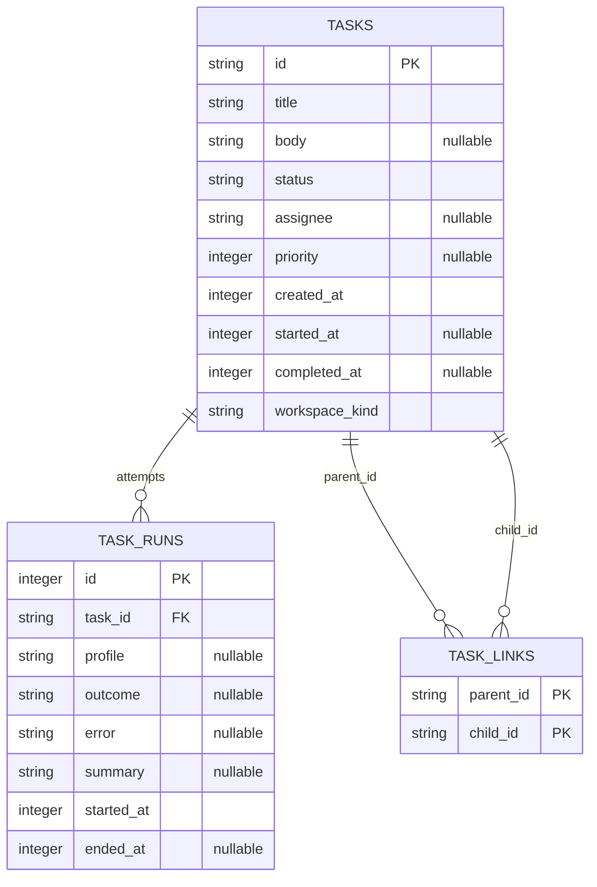

# MC task detail overlay v1.0.0

Status: candidate additive contract; Keystone owns; Meridian verifies source/data semantics before Piston builds. Source task t_d02b1169. No approved pipeline grouping, retention, filters or auth semantics are replaced. Implementation only in /opt/data/hermes-mission-control; no dependencies, deployment, publication, restart, /opt/hermes edits or Kanban writes.

## 1. Domain and invariants

One response per stored task, including archived and standalone cards. Direct parent/child links, not transitive ancestry or exclusive pipeline ownership. Return unique IDs sorted lexically, including dangling IDs: clicking a missing target gives explicit 404 with Back available. No graph traversal or cycle mutation. Latest run = greatest task_runs.id INCLUDING open runs. attempts = count of ALL runs for task, including review and blocked runs, not consecutive_failures or number of crashes. No runs => latest_run null, display 0 attempts / No run recorded. Latest run outcome is verbatim nullable string; permit running null, review_requested, changes_requested, reclaimed, spawn_failed and unknown values rather than forcing everything into failed/completed. Never infer gave_up from a later task event when latest run actually says crashed. Task status and run outcome are independent; assignee is current tasks.assignee, profile is latest run profile.

All task fields preserve source values/nulls, including null priority, body, timestamps; no epoch-zero normalization or synthetic completion. status_label reuses pipeline mapping: triage/todo/ready/scheduled Queued; running Running; blocked Blocked; review In review; done Done; archived Deferred; unknown raw status. Priority null displays unavailable; assignee null Unassigned. Full error and summary strings are preserved without clipping, markup parsing or replacing error with tasks.last_failure_error (that field is only an excerpt). UI shows Error then Summary if both nonempty; neither => No error or summary recorded. A null outcome with a run displays In progress only if ended_at null; otherwise Outcome not recorded. Raw status remains visible alongside label if different.

## 2. API, auth and reader

Add only GET /v1/tasks/{task_id}, existing _auth dependency/principal resolution, owner and guest/read-only allowed. Preserve existing query-token/bearer precedence, expiry and revocation. Anonymous behavior unchanged from current configuration. No write route or control. Use encodeURIComponent(id) in browser; parameterized exact string ID lookup, no new format restriction or SQL concatenation. API contract is adjacent task-detail-v1.0.0.openapi.json, OpenAPI 3.1 with closed JSON Schemas. Epoch seconds on wire; raw source data, not locale strings. Return Cache-Control: no-store on success and errors to prevent shared caching of private body/error content. Never include tokens in evidence or logs.

Success 200 is EXACT requested fields: id,title,body,status,status_label,assignee,priority,created_at,started_at,completed_at,latest_run,parents,children,workspace_kind. latest_run EXACT outcome,error,summary,attempts,ended_at,profile. Unknown ID 404 {error:{code:'task_not_found',message:'Task not found'}}. Board read failure 503 {error:{code:'board_unavailable',message:'Board unavailable',reason:'read_error'|'schema_mismatch'|'busy'}}. Existing auth 401 remains unchanged. Missing/corrupt required source/schema, conversion failure, locks and permissions must never become 404 or empty success. No raw filesystem/SQL errors in responses. Missing optional source values are null, not failures. No fallback empty database.

Implement isolated server/task_detail.py read function; minimal app.py route integration BEFORE static catchall. Read configured db.KANBAN_DB/MC_KANBAN_DB with escaped absolute SQLite URI mode=ro, query_only=ON, busy_timeout<=200ms. Explicit BEGIN read transaction; task row, latest run, count and direct links share ONE snapshot. Close finally on every branch. No DDL, journal changes, writes, board hooks or CLI subprocess in request. No N+1 run-count join fanout; task_runs may be absent in an older schema => explicit schema_mismatch (not a fabricated no-run card). Rank latest independently from counting attempts. Use fresh reads on open and existing state poll/SSE refresh, no long-lived body cache. Do not enlarge /v1/state with all task bodies.

Data-team boundary: operational read projection only, no new Bronze feed, source columns, event contract, warehouse definition or persistent replica. Shared latest-run and attempts semantics match KPI v1.0.0. Latency tradeoff: one indexed point read per open/current refresh in exchange for current failure text and read-transaction consistency; no premature global detail caching.

## 3. Overlay state and interaction

Keep pipeline panel layout/grouping/collapse/filter/hash byte-for-byte in behavior. Every rendered root row and milestone is activatable with pointer and Enter/Space (native button for title/milestone action, row delegated click for noninteractive area). Never nest buttons; +more/less and other existing controls stop propagation. Correct root uses task_id, milestone uses id. Use stable data-task-id for actions/tests. Do not navigate or change hash on open, linked traversal, Back or close.

One dialog instance role=dialog aria-modal=true aria-labelledby=taskDetailTitle; persistent title/loading label, visible X with accessible Close task details. States closed/loading/ready/not_found/unavailable/auth_required. Opening captures ORIGINAL opener element and stable task-id/action key before any rerender; focus X initially, trap Tab/Shift+Tab over currently enabled dialog controls, keep background inert and lock document scrolling; restore previous inert/overflow state on close. Esc/X/backdrop (only event target===backdrop, not child clicks) close. Cancel pending request on close; Escape must work even loading/error. On close focus original opener if connected, otherwise reacquire same task-id/action after polling rerender; if filtered/removed, focus pipeline heading with tabindex=-1 as honest fallback. Never focus a removed node.

Dialog content order: (1) title/status/assignee/priority, (2) created/started/completed times, running elapsed, (3) Latest run outcome/attempts/profile/ended time/full error and summary, (4) full Body, (5) parent and child buttons, (6) monospace task ID with Copy ID. Body null/empty => No body recorded. All unknown times => unavailable. All absolute times use explicit Asia/Jakarta Intl DateTimeFormat h23, full date/time/seconds + literal WIB, regardless of browser timezone. Running elapsed uses current latest run.started_at if known; because requested detail shape does NOT expose run start, use tasks.started_at for v1 detail (no hidden new field). max(0,floor(now/1000)-started_at); null => elapsed unavailable. This intentionally differs from KPI fallback; do not claim exact latest-run elapsed. Recompute on each existing refresh, including when state fingerprint unchanged through normal state poll; no new timer/poller/service. Refresh open detail on next existing refresh tick; dedupe in-flight refreshes, abort superseded opens; generation/ID guard prevents slow A from overwriting B or resurrecting closed overlay. Do not replace dialog DOM/focus or reset body scroll on unchanged refresh; patch fields, preserve keyed focused controls.

Parent/child click pushes current id AND body scroll position on local history stack, replaces content in same dialog, focuses title (tabindex=-1), never captures a new external opener. Back button appears when stack nonempty and restores prior card/scroll; navigation errors retain Back. Back is internal, does not use window.history/hash. Root cycles are safe local navigation, no recursive loading.

Use textContent for ALL source fields and errors, no innerHTML with raw values, markdown, auto-linking or inline handlers. Full strings available via scroll; body/error white-space:pre-wrap; overflow-wrap:anywhere. Copy uses clipboard API; permission failure exposes selectable exact ID and inline Copy unavailable, no mutation or remote request.

Dialog uses var(--panelSolid), var(--tx), var(--mu), var(--line), var(--shadow) and existing semantic status tokens; no fixed dark backgrounds or white text. Desktop bounded width min(760px,viewport-32px), max-height calc(100dvh - 32px), scrollable inner content, reachable pinned header/close. <760px full-height sheet inset:0,width:100%,height:100dvh,max-height:100dvh,border-radius:0 with safe-area padding. No horizontal page overflow. Body region scrolls; header never scrolls out of reach. Native keyboard focus visible in both themes. Dialog is read-only even owner: no edit/retry/approve/status controls or mutating fetch calls.

## 4. Required implementation proof, not claimed by design

Piston must paste commands/output/exit codes plus machine comparison and XSS evidence BEFORE review. Use real API/browser, existing test tools, no new dependencies. Unit fixture databases/test outputs inside MC repo only; never seed XSS or mutate status/links in live kanban.db. Controlled browser response interception may supply hostile body and must be labelled fixture, not live data.

1. Live GET t_508a98ba and read-only canonical show capture: compare exact title, assignee, raw status, created_at, started_at, completed_at programmatically (canonical kanban_show tool or read-only CLI show permitted as evidence, not board operations). Compare latest run outcome,error,summary,profile,ended_at and attempts against full run list sorted by id. Paste per-field actual/expected/PASS, not by-eye claims. Full protocol-violation text in API and DOM, outcome crashed, all-run attempt count. Screenshot + DOM assertions.
2. Real completed card: exact completed_at displayed WIB; running card elapsed advances on next existing poll and status/time transitions reflect fresh GET. Browser timezone explicitly not Asia/Jakarta. Null-time/no-run fixtures distinguish unavailable from zero.
3. Pointer AND keyboard root/milestone opening; parent and child replace same one dialog; Back restores card; original milestone focus returns after close including intervening pipeline rerender. Esc/X/backdrop independently asserted, Tab/Shift+Tab trapped, child click does not close, filter hash and pipeline expansion unchanged.
4. XSS fixture body literal `` plus ``: unit literal text assertions plus browser textContent equality; dialog contains zero img/script from payload; no alert execution or sentinel change. Repeat hostile title,error,summary and linked ID. Never write hostile body to live board.
5. Desktop light/dark and 390px/320px mobile: screenshots, computed token colors/contrast (WCAG normal text>=4.5:1), geometry assertions sheet covers viewport, body scrollHeight>clientHeight, close rectangle within viewport, no page horizontal overflow.
6. Auth real guest read 200, unknown404, unreadable/missing schema/busy503 error envelopes, 401 unchanged; guest query and bearer both. Enumerate routes/methods: no task-detail mutation endpoint; browser network capture has only GET detail. Regression auth mutation guard remains intact.
7. SQLite authorizer/trace against isolated copied board proves no INSERT/UPDATE/DELETE/DDL; transaction snapshot test, dangling links, no runs, open latest run after prior crash, unknown outcome, null source fields, race A/B/close, stale response and clipboard rejection. Static no writes/unsafe HTML; existing pipeline/KPI/auth suites and git diff --check pass.

LIVE DISCREPANCY: source inspected for this design already has t_508a98ba status archived, latest run189 crashed, and eleven total runs. Archived milestones remain included in pipeline v1.0.2 IF their ancestor root survives completed-pipeline retention; do not reopen or change retention to force a screenshot. Piston first checks actual panel DOM/state; if target omitted, show direct live detail plus labelled seeded pipeline click, and explicitly mark original live-click criterion unmet pending CEO acceptance. Do not silently substitute fixtures for live proof. Null completed_at on archived is correct, not a completed card.

## 5. Routing and collision control

Meridian contract review precedes implementation via task dependency; corrections documented as versioned additive amendments, no silent approved-architecture changes. Piston builds serially AFTER current KPI t_3ca1f500 to avoid shared web/index.html and server/app.py collisions, preserves approvals/org/Decision Board work, stages only owned files. Keystone independent review after build; evidence gaps block acceptance, not permission to claim live completion. No service reload/deployment without user authorization; isolate real service for tests and record exact live activation gap.

Journal: goal fix unambiguous detail/attempt/link/accessibility contract; observable result source/schema/auth/pipeline audit, explicit archived-target discrepancy, versioned domain/API/data and browser acceptance contract; evidence task-detail artifacts and canonical live capture; next Meridian validation then Piston implementation. agent_journal tool is not exposed; durable journal recorded here and task handoff.
