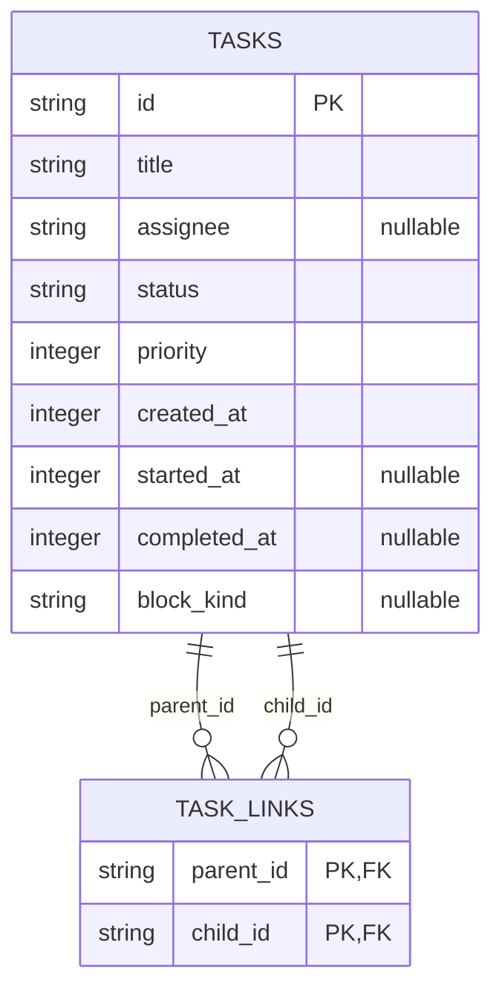

# Mission Control — additive Task pipeline contract

## 1. Scope and inspected baseline
Read-only projection of existing tasks/task_links in /opt/data/kanban.db; SQLite, current plain uvicorn process, no migrations, tables, dependencies, or permanent services. No commands or milestone mutations. No deployment/publishing without explicit user approval in chat. CEO verifies the running panel after Keystone reviews Piston's evidence.

Inspected server/reducer.py (reduce_tasks, reduce_state, activity_fingerprint), server/db.py (KANBAN_DB, open_ro), server/app.py (/v1/state calls reduce_state), web/index.html and live sqlite_master read-only. Existing `.card.queue` already has heading Task pipeline: DO NOT rename/change it. New heading deliberately duplicates it, distinguished by #taskPipelinePanel below .card.org. Existing order, contents, dimensions and CSS remain unchanged; inserting a new flow row necessarily shifts subsequent content downward, which is the only permitted movement. The event stream is an existing overlay: leave it untouched.

Prior interrupted Piston work left untracked server/pipeline.py and tests/test_pipeline.py. These are drafts, not approved implementations. Notably they use status_display instead of required status_label. Reconcile, do not blindly replace or commit unrelated logs/decisions.log or web/_org-shot-60-40.png.

## 2. Domain and read model

This depicts EXISTING storage, not new DDL. Pipeline grain = parent task with at least one valid linked child. Milestone grain = direct edge (parent_id, child_id); multi-parent children count once in each parent's rollup. No recursive descendant aggregation. A child with children independently qualifies as another pipeline. Orphan edges ignored. Only done and archived are terminal; review/scheduled and unknown statuses remain active. Unknown status labels fall back to the raw status and neutral color.

All milestone rows, including archived, remain in milestones. total = count(status != archived); done/running/blocked count exact corresponding status; deferred = count(archived). pct = floor(100 * done / max(total,1)). Rollups cover ALL direct children before collapse, never just visible children. Parent status is raw stored status, not overwritten by rollup.

Include when parent OR any direct child is non-terminal, OR a terminal parent/child has completed_at between now-604800 and now inclusive. Clock is injectable epoch seconds; boundary inclusive. Null/0 terminal completion is unknown, not recent. Source has NO archived_at column: use completed_at as the available terminal timestamp proxy; exact archive-transition recency cannot be recovered from the listed columns. Do not invent archive timestamps or add tables. Meridian must explicitly verify this bounded interpretation; raise any material mismatch to CEO before changing approved scope.

Milestones sorted (blocked first, created_at asc, id asc). Pipelines sorted (rollup.blocked desc, rollup.running desc, priority desc, created_at asc, task_id asc). Null priority becomes 0; nullable timestamps become 0; valid epochs are integer seconds. Nullable assignee stays JSON null and displays Unassigned. block_kind maps to blocked_kind (nullable string). Never classify as blocked solely because stale block_kind is non-null.

## 3. API and failure contract
Extend the existing authenticated GET /v1/state object (same HTTP/auth behavior) with:
- pipeline: Pipeline[] (always array, including failure).
- pipeline_available: boolean (true for successful read, including empty board).
- pipeline_error: null | literal string "board unavailable".

Pipeline required keys: task_id:string, title:string, lead:string|null, status:string, status_label:string, priority:integer, created_at:integer, rollup:Rollup, milestones:Milestone[].
Rollup required integer nonnegative keys: total, done, running, blocked, deferred, pct (0..100).
Milestone required keys: id:string, title:string, assignee:string|null, status:string, status_label:string, started_at:integer, completed_at:integer, blocked_kind:string|null. No status_display alias. created_at is used internally for milestone sort and need not be exposed.
OpenAPI 3.1 fragment accompanies this document; it extends rather than replaces the existing state schema.

Missing file, exclusive SQLite lock, schema drift (missing required columns/tables), read/decoding/conversion failure: pipeline=[], pipeline_available=false, pipeline_error="board unavailable"; authenticated /v1/state MUST still return 200 and preserve all unrelated fields and normal rendering. No raw paths or SQL errors in browser payloads. Never return last successful pipeline as if available.

## 4. Exact implementation files/interfaces
- server/pipeline.py: pure projection reader `read_pipelines(path: str | None = None, now: float | None = None) -> dict`, returning the THREE top-level fields above. path defaults to the existing `db.KANBAN_DB` / MC_KANBAN_DB configuration (default /opt/data/kanban.db), not a separate incompatible switch. URI built with correctly escaped absolute path and mode=ro; PRAGMA query_only=ON, busy timeout <=200ms, explicit close in finally (sqlite connection context manager alone does NOT close). One consistent read transaction/join snapshot, local aggregation; no writes, migrations, polling threads or new cache. Validate required projection columns before query. Failures isolated at this module boundary and reducer merge.
- server/reducer.py: call reader in reduce_state(now=now), merge only new fields. Existing reduce_tasks currently executes unguarded SQL; minimal defensive wrapper around its open/query must return its existing empty tasks + zero task KPI shape on SQLite/OSError failures, with normal successful behavior unchanged. This is required for the real whole-route kill-test, not a fake mocked 200. Do not replace other reducer logic. Existing activity_fingerprint remains sufficient for live board task events; existing /v1/state polling refreshes quiet/fixture/recovery cases. No new watcher.
- server/app.py: no endpoint/auth change needed; current /v1/state already calls reduce_state. Only change if a focused test demonstrates essential integration need; explain any deviation.
- web/index.html: insert `<section class="card n12" id="taskPipelinePanel">` immediately after closing `.card.org`, before #logsCard. Heading Task pipeline; body #taskPipelineBody. New CSS selectors scoped to #taskPipelinePanel / .pipeline-* only. Add `renderPipeline(state)` invoked from existing mapState and from refreshState BEFORE hasData early-return, so fixture-only and unavailable boards render even when legacy hasData is false. Do not change hasData semantics or other renderers. Existing SSE snapshot calls mapState, so it shares renderer. Do not create a second fetch loop.
- tests/test_pipeline.py: reader math/filter/order/schema/lock/readonly unit tests.
- tests/test_pipeline_api.py: actual route success and fault-isolation tests.
- tests/test_pipeline_ui.*: DOM/browser assertions; choose extension matching already installed test runner, report chosen file. No added runtime packages. Local transient test browser/uvicorn process is allowed; no permanent service.
- docs/task-pipeline-v1.0.0.md and docs/task-pipeline-openapi-v1.0.0.yaml: copy this approved spec and accompanying fragment. docs/state-map.md: additive pipeline mapping only. Do not touch existing schemas or service manifests.

## 5. Display contract (carry this section verbatim to Piston)
Status display mapping (compute server-side, ship the display string too): `triage|todo|ready|scheduled` → `Queued`, `running` → `Running`, `blocked` → `Blocked`, `review` → `In review`, `done` → `Done`, `archived` → `Deferred`.

No separate colour table was supplied in the source card; the following is the explicit mapping for this additive panel. No new WCAG audit/workstream or global theme changes are in scope; reuse current theme variables and visible labels.

| Raw status | Display string | Colour token | Meaning |
|---|---|---|---|
| triage\|todo\|ready\|scheduled | Queued | var(--am) | Queued |
| running | Running | var(--cy) | Running |
| blocked | Blocked | var(--rd) | Blocked |
| review | In review | var(--vi) | Awaiting review |
| done | Done | var(--gr) | Complete |
| archived | Deferred | var(--mu) | Excluded from total |
| unknown | raw status | var(--mu) | Unknown state |

Parent row: bold title, lead chip, server status_label pill, done/total, pct progress bar. Blocked-child count >0 adds scoped red border/accent and visible Blocked label even if parent running. Milestone: colored dot plus server status_label text, title, assignee chip. All title/assignee/status data must be textContent or safely escaped, never raw HTML interpolated.

Running child with started_at>0 shows `Started DD/MM/YYYY HH:mm:ss WIB · elapsed Hh Mm Ss`. Use Intl.DateTimeFormat with timeZone Asia/Jakarta, hourCycle h23 and explicit WIB suffix; elapsed = max(0, floor(Date.now()/1000)-started_at), a timezone-independent duration. started_at=0 shows `Start time unavailable`, never 1970. Reuse existing UI refresh cadence; no extra server requests/timer service. All new absolute times render WIB, never UTC; do not rewrite pre-existing API ISO fields.

More than four children: show first four in server order; button `+N more` where N=milestones.length-4, expands all; Show less collapses. A sessionStorage key namespaced by task_id remembers state across refresh/reload in the same tab only (fallback in-memory if unavailable); no localStorage or board writes. Empty successful read: `No decomposed tasks in flight.` Failed read: `board unavailable` (takes precedence). Missing availability fields in old replay payloads also renders unavailable, not invented data. Parent/assignee chips are display only. Progress bar uses pct; text remains available independent of color.

## 6. Fixture and acceptance evidence
NEVER seed/modify/lock the live /opt/data/kanban.db. Use TemporaryDirectory under task workspace or TMPDIR, isolated fixture board.db and MC_DB; process-scoped MC_KANBAN_DB before import/start (not production .env). For whole route, fixture schema must also include existing legacy reader fields consecutive_failures and workspace_path; task_events may be empty for current fingerprint. Create these only in temporary fixture, not production. For unrelated sources use isolated valid existing test fixtures/mocks of non-board dependencies, NOT a mocked pipeline or HTTP response. Freeze clock for exact baseline comparisons.

A: parent p, lead keystone, running, priority 8; direct children d=done, r=running, b=blocked with assignees piston/meridian/relay and ascending created_at d,r,b. Expected order b,d,r; rollup {total:3,done:1,running:1,blocked:1,deferred:0,pct:33}. Paste actual authenticated GET JSON + HTTP 200.
B: add archived child a: total remains 3, deferred=1, pct=33; add fifth queued child q for collapse: total=4,done=1,running=1,blocked=1,deferred=1,pct=25; initial visible=4 and +1 more. Also test all archived total=0,pct=0; never manufacture successful evidence.
C: assert terminal recent inclusion at exact seven-day boundary, expired exclusion, recent child inclusion, parent active/child active, review/scheduled active, multi-parent and nested direct-only aggregation, deterministic ties, null assignee/timestamps, unknown statuses and escaped hostile titles.
D: DOM assertions or real screenshot show new panel below org, correct parent lead/status/count/bar, every milestone assignee, blocked first/accent, WIB start (known epoch), elapsed clamping, collapse/expand survives refreshed data in tab; old queue/Org structure and other selectors/markup unchanged. Assert empty and unavailable separately, including no legacy agent data and SSE updates.
E: real route kill-tests: MC_KANBAN_DB=nonexistent path (assert file not created), schema-drift fixture, and separate connection BEGIN EXCLUSIVE on a DELETE-journal fixture. Reader returns bounded failure; actual /v1/state 200 and exact unavailable triplet; DOM board unavailable. Non-board payload fields identical to frozen baseline; board-derived legacy tasks/KPIs may be empty when source genuinely inaccessible, but keys/types and all panels survive. Unlock/recover without server restart (or restore path in same test) proves next read available. Record measured reader lock latency; no multi-second lock stalls in legacy wrapper (bound its board connection timeout too without changing non-board connections).
F: read-only proof on the ACTUAL reader connection: intercept/instrument connection creation in test to assert mode=ro and PRAGMA query_only=1 and rejected attempted UPDATE. Compare fixture DB contents before/after read and schema list; report no new production tables/services. Do not claim a separate readonly connection proves reader query_only. Run existing regression suite and paste command, exit code and test counts. Paste focused results, actual JSON, DOM evidence, changed file list, commit/diff references, and no-write/no-service statement on Piston card. No deployment.

## 7. Handoff and review gates
Meridian first verifies data semantics, archive timestamp limitation, JSON types, read-only isolation and retention math; no ingestion/lakehouse changes. Piston implements only after that contract check passes, then requests same-card review from Keystone with actual evidence; Keystone must independently inspect/re-run before approving implementation. Ownership card t_0eb1c476 waits on implementation, then requests CEO review/verification of running panel before closing. CEO controls any authorized deploy/restart; do not silently deploy to satisfy running verification. Spec is not a claim the feature exists.

Trade-offs: one bounded read per existing state refresh avoids a new service/cache but repeats a small join; consistent snapshot over eventual stale cache. Direct-child denormalized JSON matches panel grain; not a new storage or ingestion contract. Archive recency uses available timestamp proxy, not event history. Fail closed on panel data, fail open on dashboard availability.
