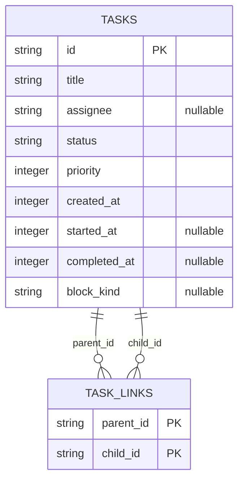

# Mission Control — Task pipeline v1.0.2

## Changelog
- **3-completed cap:** all active pipelines plus only the three most recently completed pipelines; add pipeline.completed_at and state.pipelines_omitted. Replaces the seven-day eligibility window.
- **Transitive root grouping:** one row per top-most root, all-depth descendants, deterministic exclusive attribution for multi-root cards and dedupe; add milestone.also_under and milestone.also_under_note.
- **Emergent flag:** server-computed milestone.emergent/origin_label and rollup.planned/emergent make scope growth visible.

All existing JSON keys, types, status mappings, auth, HTTP behavior and unrelated panels remain. Existing versioned documents remain unedited. This document and task-pipeline-openapi-v1.0.2.yaml are the complete normative target, replacing older grouping/retention semantics only as expressly authorized by t_87c85ae7. No implementation/deployment claimed.

## 1. Domain first: storage and invariants
Read-only existing /opt/data/kanban.db, tables tasks and task_links. Inspected live sqlite_master with mode=ro: tasks has integer created_at NOT NULL, nullable integer started_at/completed_at and nullable block_kind; task_links has composite PK(parent_id, child_id), no foreign key declarations. No archived_at. No DDL, write actions, new tables, services, dependencies, cache, kanban-semantic changes or per-milestone costs.

Relationships above are logical; missing endpoint edges are ignored before graph resolution. A task with only dangling incoming links is therefore a root in the valid graph. Standalone tasks without valid descendants remain outside this decomposed-task panel.

### 1.1 Root resolution and exclusive ownership
Use the complete valid graph in one consistent snapshot, before status/time filtering. Walk incoming parent links transitively to obtain the SET of all ancestor roots for each task (root = no valid incoming parents). Never stop at a direct parent or archived intermediate task. A grandchild/re-review spawned from findings stays under its original root. Do not impose a depth limit; use an iterative DAG traversal/root-set propagation or equivalent bounded-by-graph algorithm, not enumerating every distinct path.

For every non-root task, choose owner root = minimum (root.created_at, root.id), ascending; ID is binary/ordinary string lexical comparison, not locale-sensitive. All other reachable roots count toward also_under, even if they later fail the display selection. Attribute the milestone ONCE globally to its owner root. Reaching the same root by several paths does not increase also_under; dedupe by task id, not path/edge. Do not sever traversal at a task attributed to another root: compute each descendant's full ancestor-root set independently before ownership assignment.

A pipeline is a root with at least one assigned descendant. A losing root with zero assigned descendants has no decomposed row (and is not counted as an omitted pipeline). Roots are never their own milestones. Pipeline fields title/lead/status/status_label/priority/created_at come from the root; raw root status is never overwritten by rollup. All assigned descendants at every depth, archived included, appear in milestones. Intermediate parents are milestones, not independent pipelines.

Corrupt graph handling: PK prevents duplicate edges, not cycles. Detect any valid directed cycle (including a self-edge) with visited/topological accounting; fail the pipeline projection with the existing unavailable response rather than loop or invent a root. Orphan edges alone are ignored. No changes to stored links or kanban behavior.

### 1.2 Rollups and emergent classification
Only done and archived are terminal; review, scheduled and unknown raw statuses are active. Unknown labels fall back to raw status with neutral color. Let M be unique assigned descendants, U = M excluding status archived:
- total = |U|; deferred = count(archived in M).
- done/running/blocked count exact matching status in U. A stale non-null block_kind alone does not imply blocked.
- pct = floor(100 * done / max(total,1)).
- first_milestone = minimum (created_at,id) over ALL M, including archived; compute before blocked-first display sorting/collapse. This is earliest creation, NOT the first displayed milestone.
- If root.started_at IS NOT NULL, emergent = milestone.created_at > root.started_at. A stored zero is non-null and uses this branch. Compare source nullness before timestamp normalization.
- Otherwise emergent = milestone.created_at > first_milestone.created_at + 60 (seconds).
- Strict > in both branches: equality at started_at or fallback +60 is planned. +61 is emergent. Every milestone, including archived, ships the classification, but archived is excluded from both planned and emergent rollup counts.
- origin_label = literal "added mid-flight" iff emergent is true; otherwise JSON null.
- planned = count(not emergent in U); emergent = count(emergent in U); planned + emergent = total.
- also_under = number of distinct other ancestor roots = |root_set|-1. also_under_note = literal "also under N" with decimal N when N>0; otherwise null. Counts refer to roots, not alternate paths. No duplication into losing-root rollups.

### 1.3 Active/completed selection and completion time
A pipeline is active if its root OR any ASSIGNED descendant has status outside {done,archived}; otherwise it is completed (including all-archived). Archived intermediate nodes still connect their descendants. Pipeline.completed_at is the maximum of stored completed_at over root and ALL assigned descendants, nulls normalized to 0; compute for active pipelines too. It is a source timestamp aggregate, not a fabricated archive-transition time or a promise that an active pipeline is complete. No archived_at exists; all-archived rows may have completed_at=0.

Return every active pipeline without any age cutoff. Among completed candidates return only the first three under (-completed_at, created_at, task_id). Unknown completion 0 sorts after known positive completions. Six completed candidates yield exactly three and pipelines_omitted=3, irrespective of age. pipelines_omitted = max(number_of_completed_candidates - 3, 0), never counts active or orphan/standalone/zero-assignment roots. No seven-day prefilter or lower/upper timestamp eligibility: this explicitly supersedes v1.0.1 retention. Do not invent now for missing completion or clamp a stored future completion. A future stored completion is ranked as stored; it no longer has retention eligibility semantics. This intentional semantic replacement must be called out when updating old retention tests.

Selection versus display are distinct: choose completed survivors by completion time, THEN apply the unchanged pipeline display order to active plus selected completed: (-rollup.blocked, -rollup.running, -priority, created_at, task_id). Milestones remain (blocked first, created_at asc, id asc). The task's "blocked first, then created_at/id" describes milestone ordering, not removal of existing pipeline running/priority sort keys. Ordering never relies on insertion/SQL order. Null priority=0; nullable API timestamps=0; non-convertible required values fail projection rather than invent data. Epoch seconds only, not milliseconds/ISO.

## 2. API and schema contract
Existing authenticated GET /v1/state and transport/auth unchanged; OpenAPI 3.1 extension is supplied. Keep pipeline/pipeline_available/pipeline_error and every existing Pipeline/Rollup/Milestone property with its type. Forbidden aliases available and status_display remain forbidden.

Add REQUIRED fields:
- State: pipelines_omitted: integer >=0 (0 on empty/failure).
- Pipeline: completed_at: integer >=0 epoch seconds, aggregate defined above.
- Rollup: planned, emergent: integers >=0.
- Milestone: emergent: boolean; origin_label: "added mid-flight"|null; also_under: integer >=0; also_under_note: string|null with exact relationship above.

Existing keys retained: Pipeline task_id,title,lead,status,status_label,priority,created_at,rollup,milestones; Rollup total,done,running,blocked,deferred,pct; Milestone id,title,assignee,status,status_label,started_at,completed_at,blocked_kind. lead/assignee/blocked_kind retain nullability; nullable assignee displays Unassigned. Internal milestone.created_at and root.started_at need not be exposed. No renamed keys or removals. additionalProperties:false on closed nested schemas is extended with the new properties; do not relax it to hide accidental keys.

Failure: pipeline=[], pipeline_available=false, pipeline_error="board unavailable", pipelines_omitted=0. Existing failure triplet remains exact, with only the new additive count. Empty success = [],true,null,0. Missing/schema-drifted/locked/unreadable source or invalid cycle/conversion fails the projection; actual authenticated route stays HTTP 200 and preserves unrelated state. No raw SQL/path/error leak, no stale cached success. A failure omits no known pipelines: count must be 0, never guessed.

## 3. Reader and integration contract
server/pipeline.py read_pipelines(path=None,now=None)->dict remains existing public entry point (now remains supported even though age filtering is removed). Existing MC_KANBAN_DB/db.KANBAN_DB config/default unchanged. URI escaped absolute path mode=ro, PRAGMA query_only=ON, busy_timeout<=200ms, explicit close finally, one consistent read snapshot for tasks and links. Compute graph/ownership/rollups before selection. Local aggregation trades more graph work per refresh for correctness without a stale cache; propagate distinct root sets, never enumerate exponentially many paths. No new watcher or polling loop.

server/reducer.py merges all four pipeline extension fields; preserve existing defensive legacy reduce_tasks empty-tasks/zero-KPI fallback for board failure. Do not alter non-board sources. server/app.py needs no endpoint/auth change. Scope files: server/pipeline.py, server/reducer.py as needed, web/index.html, focused pipeline tests, additive docs/state-map.md and new versioned docs. Preserve unrelated dirty logs/decisions.log and web/_org-shot-60-40.png. No deployment, publication, live restart, .env edits or live board mutations.

## 4. UI contract
Retain #taskPipelinePanel.card.n12 immediately below .card.org and before #logsCard; heading Task pipeline, body #taskPipelineBody. Existing .card.queue heading also Task pipeline stays unchanged. Scoped CSS only; unrelated panels/order/markup unchanged. Existing initial/poll/SSE renderPipeline before hasData early returns remains functional even with no agents.

Server status_label mapping and dot/pill color tokens unchanged:
| Raw status | Label | Token |
|---|---|---|
| triage/todo/ready/scheduled | Queued | var(--am) |
| running | Running | var(--cy) |
| blocked | Blocked | var(--rd) |
| review | In review | var(--vi) |
| done | Done | var(--gr) |
| archived | Deferred | var(--mu) |
| unknown | raw status | var(--mu) |

Root bold title, lead chip, status pill, done/total/pct bar and blocked-count red accent unchanged. If rollup.emergent>0 append subtitle `planned X / added Y` using server counts (X=planned,Y=emergent). Each emergent milestone has distinct `⚑` plus server origin_label `added mid-flight`; planned stays plain. When also_under>0 show server also_under_note `also under N`. Do not derive classification/ownership from order or browser clock. Render all untrusted data as text/escaped; test hostile notes/titles. One panel-bottom line `+N older pipelines hidden` iff pipelines_omitted>0; do not confuse with per-row +N more. Failure takes precedence and must clear old counts/notes.

Retain four-milestone collapse in server order, +N more / Show less, namespaced task-id sessionStorage persistence across same-tab refresh/reload, in-memory fallback, no localStorage or board writes. Rollups use all milestones, not visible four. Empty success: No decomposed tasks in flight. Unavailable/old replay without availability: board unavailable. New additions absent in historical replay may default display counts to 0 and no marker; never derive emergent heuristically.

Running milestone shows Started DD/MM/YYYY HH:mm:ss WIB · elapsed Hh Mm Ss using Asia/Jakarta/h23 and explicit WIB; no start shows Started unavailable (existing approved implementation wording). Duration=max(0,floor(Date.now()/1000)-started_at). All absolute times WIB. No extra fetch/timer service or modifications to legacy ISO fields.

## 5. Acceptance and real evidence
Use only temporary fixtures under workspace/TMPDIR, isolated MC_DB/MC_KANBAN_DB before import/start; no live experiments or board changes/locks. No dependency installation needed: /opt/hermes/.venv/bin/python has fastapi/httpx; standard unittest runner. Pipeline/HTTP must be real; unrelated sources may use existing isolated mocks with frozen clock. Paste actual JSON, exact command/exit/test count, diff reference, DOM assertion output and screenshots on Piston card.

1. Root r(created=100,started=200), child c(created=150), grandchild g(created=180), late l1(created=201), l2(created=202), all reachable from r; second root s(created=110) links shared x(created=190) also under r. Add diamond c->g and another intermediate path to g. Assert r contains every assigned descendant exactly once including g and exactly l1/l2 emergent among these; x appears only under r, also_under=1,note='also under 1'. Assert losing s has no duplicate x; a separate exclusive s descendant can keep s row visible. Reverse insertions yield identical payload. Equal-root-created_at uses root.id; count distinct roots despite multiple paths. Archived intermediate descendant does not sever g; deferred excluded from planned/emergent/total.
2. Six completed roots each with assigned descendant -> exactly three, omitted3; test age>7d still eligible, root versus grandchild completion max, completion ties, unknown zero, future stored timestamp, archived-only terminal, all active retained even when older than 7d. Completion ranking selects survivors but does not replace existing display sort. Active root with done descendants and done root with active grandchild both remain active.
3. Strict boundaries: created==root.started planned, +1 emergent; null-start fallback first created+60 planned, +61 emergent, first milestone defined before blocked sort and includes archived; non-null zero-start branch; empty/standalone root does not calculate a missing first milestone.
4. Regression: keep the existing 14 test methods/coverage and passing behavior not explicitly superseded. Old direct-only/multi-parent duplication and seven-day/future-retention EXPECTATIONS must be amended to this version, not deleted or bypassed; name the exact changed assertion and spec section in evidence. Preserve all readonly/schema/lock/auth/fallback/escaping/order/UI coverage. Add tests for cycles, dangling edges, deep chain, multi-root ownership/dedupe, archived and null/tie cases, new keys/types, success/empty/failure omitted0. Additive schema audit: old properties/required keys/types retained, no new aliases.
5. Actual authenticated HTTP fixture responses for graph/emergent and six-completed cap. Isolated missing/schema-drift/exclusive DELETE lock -> HTTP200 old unavailable triplet plus omitted0, full frozen non-board payload/legacy keys/types preserved, missing file not created, next-read recovery. Preserve actual-reader mode=ro/query_only=1/rejected UPDATE with successful instrumented projection and unchanged fixture rows/schema. Record reader latency. Live kill-test belongs exclusively to CEO.
6. Executable DOM/browser assertions (not source-string tests alone): marker/label, planned/added subtitle, shared note, bottom hidden line conditional/cleared on refresh/fault, server-controlled flags despite changed ordering, existing collapse/storage/WIB/escaping and no-agent initial/poll/SSE paths. Screenshot is supplementary, not a substitute for assertions.

## 6. Handoff gates and data-team verification
Meridian verifies DAG grain, exclusive ownership, timestamp/null/boundary semantics, additive OpenAPI, and no ingestion/lakehouse impact before Piston builds. This is a read-model contract, not a Bronze/Silver/Gold source schema. Piston copies exact approved docs into repository docs/, implements and requests same-card review reviewer=keystone with pasted evidence. Keystone independently inspects and reruns then approves or requests targeted changes; no reviewer implementation. CEO performs live panel check and live kill-test after Keystone approval, before ownership closes. Do not deploy/restart to manufacture live evidence. At most two child cards (Meridian gate and Piston implementation); do not spawn another graph. Repeated same blocker twice escalates to CEO, no loop.

Trade-offs: exclusive earliest-root ownership prevents double-counting at cost of some losing roots showing fewer/no milestones; also_under communicates shared ancestry. Timestamp heuristic exposes scope growth, not proven causal provenance. Historical completed pipelines are read to select newest three; no seven-day prefilter may hide candidates. Snapshot consistency chosen over cached latency; graph traversal needs root-set dedupe to avoid path explosion. archived_at remains unknowable and no event-history reconstruction is introduced.
